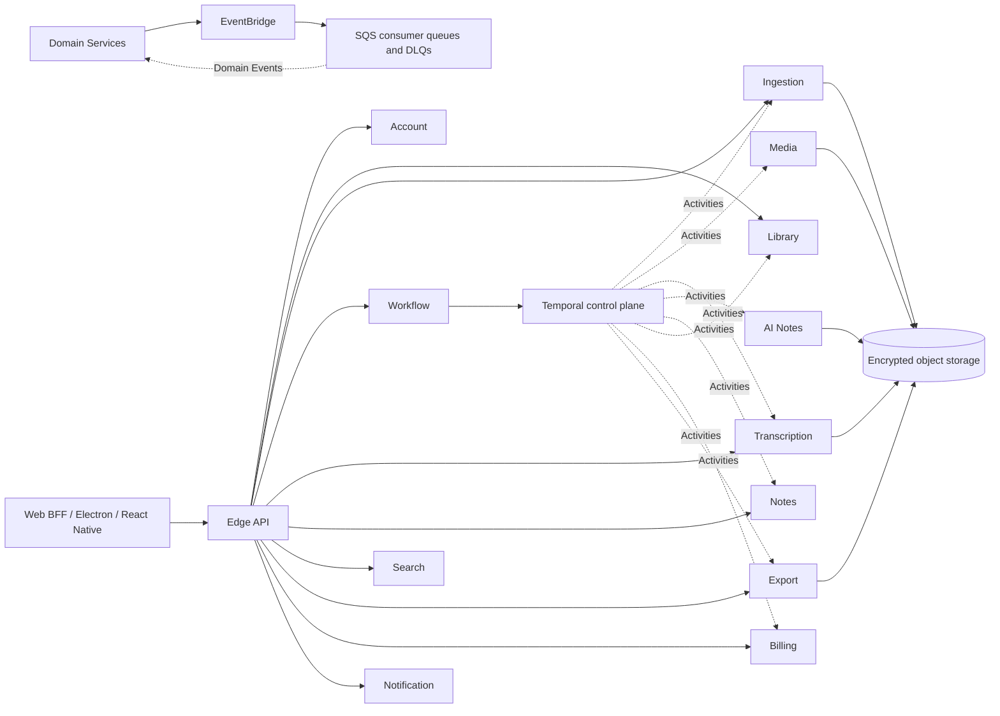

# Study Notes Creator: Service Catalog

**Document status:** Active service-boundary register  
**Version:** 1.0  
**Last updated:** 23 November 2026  
**Architecture:** Polyrepo backend microservices  
**Current delivery milestone:** M0 — Product control plane  
**Related documents:** [PRD.md](./PRD.md), [TRD.md](./TRD.md), [GLOSSARY.md](./GLOSSARY.md), [ROADMAP.md](./ROADMAP.md), [BUILD_PLAYBOOK.md](./BUILD_PLAYBOOK.md), [repos.md](./repos.md)

---

## 1. Purpose

This document is the authoritative high-level register for the **13 backend Services** planned for Study Notes Creator. It answers, for every Service:

- Why the Service exists.
- What it owns and explicitly does not own.
- Which data it is authoritative for.
- Which APIs, Domain Events, and Temporal Activities form its boundary.
- Which other Services and external systems it depends on.
- How it is expected to deploy, fail, degrade, and protect data.
- When it is activated and who is accountable for it.

This is a boundary catalog, not a substitute for implementation design. Before a Service repository is activated, it must contain an approved `SERVICE.md` using the service design gate in `BUILD_PLAYBOOK.md`.

The documents have the following authority:

| Question | Authoritative artifact |
|---|---|
| Product outcome and scope | `PRD.md` |
| System-wide technical design | `TRD.md` and accepted ADRs |
| Canonical terminology | `GLOSSARY.md` |
| Service boundary and accountability | This catalog |
| Exact durable-data ownership | Planned `DATA_OWNERSHIP.md` |
| Exact Domain Event envelope and schemas | Planned `EVENT_CATALOG.md` and contracts repository |
| Exact API and Activity schemas | Contracts repository and owning Service's `SERVICE.md` |
| Delivery order and activation gate | `ROADMAP.md` |

If these documents conflict, implementation stops until the conflict is resolved through the change process in `BUILD_PLAYBOOK.md`.

---

## 2. Catalog conventions

### 2.1 Lifecycle states

| State | Meaning |
|---|---|
| `Planned` | Boundary is approved for planning; repository has not been activated |
| `Designing` | Repository is active and its first `SERVICE.md`/feature design is under review |
| `Active` | Service has an approved boundary, deployed implementation, named owner, and runbook |
| `Deprecated` | Replacement is approved; no new consumers should be added |
| `Retired` | Runtime and retained data have been safely removed or transferred |

All Services are currently `Planned`. Repository creation alone does not make a Service active.

### 2.2 Ownership

“Service owner” means the accountable human engineering owner for the Service boundary, repository, production behavior, data, contracts, cost, and runbook. AI may implement approved work but can never be the accountable owner.

Every currently unassigned owner is recorded as **TBD before activation**. Services required for M2 must have named owners before the M0 exit gate passes.

### 2.3 Contract maturity

API capabilities, Activity names, and Domain Event names in this document are **planned boundaries**. They become executable contracts only after review and publication in `study-notes-creator-contracts` or the owning repository, as prescribed by the TRD.

Domain Event names below describe facts that may be published. They are not commands, Job Events, Product Events, or raw logs. The future `EVENT_CATALOG.md` may refine a name or split an event without changing Service ownership.

### 2.4 Dependency meaning

A dependency is a required runtime or platform capability, not permission to access another Service's database. Each dependency must use one of these mechanisms:

- Versioned synchronous HTTP for a short operation whose result is immediately required.
- A Temporal Activity for durable, retryable Workflow work.
- A versioned Domain Event for asynchronous facts and projections.
- An immutable object reference for large encrypted content.

---

## 3. Non-negotiable service rules

1. Each Service has one repository, one runtime identity, independently deployable units, an owned logical database where required, migrations, CI/CD, dashboards, alerts, and a runbook.
2. A Service never reads, writes, joins, migrates, or declares a foreign key to another Service's database.
3. The owning Service enforces resource authorization even when Edge API has authenticated the caller.
4. Edge API is the only public backend entry point. It owns no business state or domain decisions.
5. A synchronous call has a deadline, propagated trace and Actor context, stable errors, bounded retries, and a circuit-breaker policy.
6. A Domain Event producer commits business state and an outbox record atomically. Delivery is at least once; consumers are idempotent and tolerate delay, duplicates, stale versions, and version gaps.
7. EventBridge routes Domain Events to a dedicated SQS queue and dead-letter queue for each consumer.
8. Workflow service owns Temporal Workflow definitions. The capability-owning Service implements its Activities and polls its task queue.
9. Cross-Service business transactions use a Saga with explicit compensation; no Service attempts distributed database rollback.
10. Events and Temporal histories contain IDs, versions, safe metadata, and immutable references—not media, Transcript bodies, Note bodies, prompts containing Private Content, access tokens, or presigned URLs.
11. Large content moves through encrypted object storage or an owner-authorized snapshot API using workload identity.
12. A Worker, API process, event consumer, or scheduled task is a deployment unit inside its owning Service repository, not a new Service by default.
13. A Service must not accumulate a second domain merely because a related Service has not yet been activated.

---

## 4. Service inventory

| # | Service | Repository | Mission in one line | Activation | State | Accountable owner |
|---:|---|---|---|:---:|---|---|
| 1 | Edge API | `study-notes-creator-edge-api` | Stable public backend boundary for every client | M2 | Planned | TBD before activation |
| 2 | Account | `study-notes-creator-account-service` | Product identity profile, preferences, consent, and account lifecycle | M2 | Planned | TBD before activation |
| 3 | Library | `study-notes-creator-library-service` | Authoritative user-owned Artifact catalog and lifecycle | M2 | Planned | TBD before activation |
| 4 | Ingestion | `study-notes-creator-ingestion-service` | Rights-aware Source validation, upload, acquisition, and source-asset retention | M3 | Planned | TBD before activation |
| 5 | Workflow | `study-notes-creator-workflow-service` | Durable Generation/deletion orchestration and user-safe Job progress | M2 | Planned | TBD before activation |
| 6 | Media | `study-notes-creator-media-service` | Isolated validation and preparation of untrusted media | M3 | Planned | TBD before activation |
| 7 | Transcription | `study-notes-creator-transcription-service` | Authoritative timestamped Transcript Versions | M4 | Planned | TBD before activation |
| 8 | AI Notes | `study-notes-creator-ai-notes-service` | Evidence-first Note planning, drafting, and quality verification | M5 | Planned | TBD before activation |
| 9 | Notes | `study-notes-creator-notes-service` | Canonical editable Note documents, versions, Citations, feedback, and shares | M2 | Planned | TBD before activation |
| 10 | Search | `study-notes-creator-search-service` | Rebuildable user-scoped search projection | M6 | Planned | TBD before activation |
| 11 | Export | `study-notes-creator-export-service` | Safe asynchronous rendering and expiry of Note exports | M6 | Planned | TBD before activation |
| 12 | Billing | `study-notes-creator-billing-service` | Entitlements, subscriptions, and auditable usage accounting | M7 | Planned | TBD before activation |
| 13 | Notification | `study-notes-creator-notification-service` | User notification preferences and multi-channel delivery | M6 | Planned | TBD before activation |

No separate authentication Service is planned. Authentication credentials are managed by an approved OIDC provider; Account owns the product profile, and every resource-owning Service owns its authorization decisions.

---

## 5. System context and dependency map



The diagram shows allowed interaction styles, not permission for arbitrary calls. Exact consumer relationships must be declared in the event catalog and each Service specification.

### 5.1 Direct dependency summary

| Service | Service dependencies | Platform/external dependencies |
|---|---|---|
| Edge API | Account, Library, Ingestion, Workflow, Transcription, Notes, Search, Export, Billing, Notification | OIDC/JWKS, rate-limit/cache facility, service discovery |
| Account | No required synchronous domain dependency | OIDC claims, PostgreSQL, EventBridge/SQS |
| Library | Workflow/Notes/Transcript facts or owner snapshots for reference reconciliation | PostgreSQL, EventBridge/SQS |
| Ingestion | Workflow through Activities; no required direct domain write | S3, approved URL/provider adapters, PostgreSQL, Temporal, EventBridge/SQS |
| Workflow | Activity contracts implemented by Ingestion, Media, Transcription, AI Notes, Notes, Library, Billing, Export | Temporal, PostgreSQL, EventBridge/SQS, stream/cache adapter |
| Media | Ingestion-owned immutable source reference | S3, malware scanner, `ffprobe`/FFmpeg sandbox, PostgreSQL, Temporal |
| Transcription | Ingestion/Media asset reference | Caption/ASR providers, S3, PostgreSQL, Temporal, EventBridge/SQS |
| AI Notes | Transcription snapshot/reference; Notes materialization contract | Model providers, S3, PostgreSQL, Temporal, EventBridge/SQS |
| Notes | AI Notes evidence/document manifest and Transcript references | PostgreSQL, S3 where needed, Temporal, EventBridge/SQS |
| Search | Library, Notes, and Transcription events/snapshot APIs | PostgreSQL search, EventBridge/SQS |
| Export | Notes authorized immutable snapshot | S3, sandboxed Markdown/PDF renderer, PostgreSQL, Temporal, EventBridge/SQS |
| Billing | Account identifier; Workflow through usage Activities | Stripe, PostgreSQL, Temporal, EventBridge/SQS |
| Notification | User-facing Domain Events; Account identity reference | Email/push providers, PostgreSQL, EventBridge/SQS |

### 5.2 High-level authoritative ownership

| Domain information | Authoritative Service |
|---|---|
| Product Account, locale/defaults, consent, account-deletion request | Account |
| Artifact ownership, title, lifecycle, current Note/Transcript references | Library |
| Source, upload session, rights attestation, raw/source asset registry and retention | Ingestion |
| Generation, Job, ordered Job Events, Workflow binding, compensation/deletion ledger | Workflow |
| Media scan/probe result, preparation execution, derived media registry | Media |
| Transcript Version, segment timing, speaker/word metadata | Transcription |
| Semantic chunks, Evidence Items, draft/evidence manifests, quality reports | AI Notes |
| Note document, Working Version, revisions, Note Versions, Citations, feedback, shares | Notes |
| Search documents, indexing checkpoints, rebuild state | Search |
| Export request, render attempt, output reference and expiry | Export |
| Plan, subscription, Entitlement, usage reservation/settlement and webhook receipt | Billing |
| Notification preference, in-app notification, device token and delivery attempt | Notification |

This table is intentionally concise. The planned `DATA_OWNERSHIP.md` will decide individual fields, retention, deletion, backup, classification, and tombstone ownership.

---

## 6. Detailed service entries

### 6.1 Edge API

**Repository:** `study-notes-creator-edge-api`  
**State / activation:** Planned / M2  
**Accountable owner:** TBD before activation  
**Persistence:** No business database; only approved ephemeral rate-limit/stream cache state  
**Criticality:** Public control path; never the long-running processing path

**Mission**

Provide one stable, authenticated, client-friendly public API while hiding internal Service topology and preventing business logic from leaking into the gateway.

**Responsibilities**

- Validate OIDC access tokens, issuer/audience, expiry, scopes, and coarse request limits.
- Propagate Actor, workload, trace, idempotency, and request context to internal APIs.
- Route or narrowly compose short synchronous calls.
- Own the public OpenAPI source and stable public error envelope.
- Proxy Job SSE with replay semantics from Workflow service and provide polling fallback routes.
- Normalize safe dependency failures without exposing provider responses or internal topology.

**Non-goals**

- Owning Accounts, Artifacts, Sources, Jobs, Notes, Entitlements, or any business database.
- Implementing domain authorization on behalf of the resource owner.
- Coordinating distributed transactions, running media/AI work, or directly publishing business facts.
- Performing dual writes or treating response composition as a new source of truth.

**Key boundaries**

- Public API capabilities: Account/settings, Library, Source/upload, Generation/Job, Transcript, Notes/share/feedback, Search, Export, Billing, and Notifications.
- Domain Events: none expected for normal routing; operational telemetry is not a Domain Event.
- Temporal Activities: none.

**Dependencies**

- Synchronous: all public-facing domain Services listed in section 5.1; never Media or AI Notes directly.
- External/platform: OIDC/JWKS, internal service discovery, telemetry, and approved rate-limit/cache facility.

**Deployment units**

- Public API/SSE process. It may scale independently but remains one Service boundary.

**Security and failure behavior**

- Tokens, cookies, presigned URLs, and private response bodies are never logged.
- Dependency deadlines are shorter than the client deadline; mutation retries require an idempotency key.
- Authentication/authorization uncertainty fails closed. Dependency failure returns a stable traceable error; Edge does not invent success or queue hidden work.

**Decisions required before activation**

- OIDC provider, public error taxonomy, public API versioning, per-route limits, SSE capacity model, and client/BFF token exchange.

---

### 6.2 Account Service

**Repository:** `study-notes-creator-account-service`  
**State / activation:** Planned / M2  
**Accountable owner:** TBD before activation  
**Persistence:** Account PostgreSQL database  
**Data sensitivity:** Personal data, consent/audit metadata; no authentication credentials

**Mission**

Own the product-level Account associated with an external authenticated identity, including profile, product defaults, consent, and account-lifecycle requests.

**Responsibilities**

- Map an approved OIDC subject to one product Account.
- Manage display/profile fields, locale/timezone, product defaults, and consent records.
- Record account-deletion requests and participate in the Deletion Saga.
- Provide minimal authorized Account snapshots to approved internal consumers.
- Keep audit evidence for consent and lifecycle transitions according to policy.

**Non-goals**

- Storing passwords, refresh tokens, MFA secrets, or operating an identity provider.
- Owning Artifact data, Note content, delivery-channel preferences, subscriptions, or usage ledgers.
- Deleting another Service's data directly.

**Key boundaries**

- API capabilities: get/create current Account, update profile/defaults, manage consent, request/cancel deletion where policy permits.
- Planned events: `AccountCreated`, `AccountProfileChanged`, `AccountPreferencesChanged`, `AccountDeletionRequested`, `AccountPurged`.
- Planned Activities: purge or anonymize Account-owned data as part of the Deletion Saga.

**Dependencies**

- Synchronous: no mandatory domain dependency.
- External/platform: verified OIDC claims, PostgreSQL, outbox, EventBridge/SQS, audit/telemetry.

**Deployment units**

- Private API, outbox publisher, and deletion Activity/worker; initially they may share one ECS task definition if scaling permits.

**Security and failure behavior**

- OIDC subject identifiers and personal data are minimized and never placed in broadly consumed events.
- Loss of OIDC connectivity does not corrupt existing Account state; new identity linkage fails closed.
- Deletion remains auditable and retryable; a partial Saga never reports the Account as fully purged.

**Decisions required before activation**

- Account bootstrap semantics, merge/link policy, consent versions, recovery window, regional privacy assumptions, and exact split between product defaults and Notification preferences.

---

### 6.3 Library Service

**Repository:** `study-notes-creator-library-service`  
**State / activation:** Planned / M2  
**Accountable owner:** TBD before activation  
**Persistence:** Library PostgreSQL database  
**Data sensitivity:** User ownership and Private Content metadata; never full media, Transcript, or Note bodies

**Mission**

Own each user-visible Artifact as the stable catalog entry that connects a Source to its evolving Generations, Transcript Versions, and Note Versions.

**Responsibilities**

- Create and authorize Artifact aggregates.
- Own Artifact title, ownership, archive/trash lifecycle, source reference, and current Note/Transcript references.
- Serve Library listing/detail projections needed by clients.
- Reconcile resource references from authoritative owner facts or snapshots.
- Participate in Artifact deletion without deleting data owned by other Services.

**Non-goals**

- Owning Source acquisition, raw media, Job state, Transcript text, Note documents, search ranking, or export files.
- Calling multiple Services on every list request to reconstruct an Artifact.
- Accepting an event as proof that the current Actor is authorized to mutate an Artifact.

**Key boundaries**

- API capabilities: create/list/get/update/archive/trash/restore Artifact and request deletion.
- Planned events: `ArtifactCreated`, `ArtifactMetadataChanged`, `ArtifactLifecycleChanged`, `ArtifactDeleted`.
- Planned consumers: Generation state, Transcript-created/deleted, Note-version-created/deleted facts needed to maintain safe references.
- Planned Activities: `set_current_note_reference` and purge/tombstone Library-owned Artifact data.

**Dependencies**

- Asynchronous: Workflow, Notes, and Transcription facts.
- Reconciliation only: authorized owner snapshots from Workflow, Notes, or Transcription when an event version is missing.
- Platform: PostgreSQL, outbox, EventBridge/SQS, Temporal Activity worker.

**Deployment units**

- Private API, projection consumers, outbox publisher, and Library Activity worker.

**Security and failure behavior**

- All reads and writes are scoped to the owning Actor; internal callers use workload identity plus original authority context.
- Delayed projection events may make a reference temporarily stale but never transfer ownership or expose another user's content.
- Missing versions trigger reconciliation; list reads can return explicit processing state without fabricating readiness.

**Decisions required before activation**

- Artifact lifecycle state machine, trash/recovery window, title precedence, reference update invariants, and deterministic M2 fake-Source representation.

---

### 6.4 Ingestion Service

**Repository:** `study-notes-creator-ingestion-service`  
**State / activation:** Planned / M3  
**Accountable owner:** TBD before activation  
**Persistence:** Ingestion PostgreSQL database plus quarantine/private source-object prefixes  
**Data sensitivity:** Source locators, rights attestations, upload credentials/state, and Raw Media

**Mission**

Turn an authorized Source locator or upload into a controlled, auditable source asset that downstream processing may safely reference.

**Responsibilities**

- Validate Source type, metadata, acquisition option, rights attestation, limits, and policy.
- Create, complete, expire, and abort multipart upload sessions using narrowly scoped presigned operations.
- Acquire content only through approved provider-specific adapters and compliant paths.
- Own Source records, raw/source asset registry, checksum, retention deadline, and cleanup scheduling.
- Prevent SSRF, unsafe redirects, unsupported schemes, and bypass of authentication/DRM/paywalls.

**Non-goals**

- Assuming that a public URL grants processing rights.
- Scanning/probing media deeply, extracting audio, transcribing, generating Notes, or owning derived media.
- Proxying large upload/download bytes through Edge API.

**Key boundaries**

- API capabilities: inspect/validate Source, create upload session, sign part, complete/abort upload, retrieve safe Source/playback metadata.
- Planned events: `SourceAccepted`, `UploadCompleted`, `AssetReady`, `AssetDeleted`.
- Planned Activities: `resolve_and_acquire_source`, schedule source/temporary cleanup, purge source assets.

**Dependencies**

- Service: coordinated by Workflow; supplies immutable source references to Media/Transcription through approved contracts.
- External/platform: S3 multipart upload, malware quarantine boundary, approved provider APIs, egress controls, PostgreSQL, Temporal, EventBridge/SQS.

**Deployment units**

- Private API, acquisition Activity workers, upload/retention cleanup workers, and outbox publisher. URL acquisition workers use restricted egress and isolation.

**Security and failure behavior**

- Source locators, signed URLs, storage keys, and Raw Media are never included in Domain Events or normal logs.
- Incomplete uploads expire and are cleaned idempotently. Invalid or unauthorized Sources fail non-retryably with safe user guidance.
- Provider or network failure leaves a resumable/failed acquisition state; it never marks an asset ready before durable validation.

**Decisions required before activation**

- Supported upload formats/limits, checksum scheme, URL allowlist/SSRF policy, retention windows, initial acquisition adapters, and approved YouTube behavior.

---

### 6.5 Workflow Service

**Repository:** `study-notes-creator-workflow-service`  
**State / activation:** Planned / M2  
**Accountable owner:** TBD before activation  
**Persistence:** Workflow PostgreSQL database plus Temporal histories  
**Data sensitivity:** Generation settings, state, safe Job Events, opaque resource references; no durable Private Content bodies

**Mission**

Coordinate durable multi-Service business processes while exposing one authoritative, user-safe view of Generation and deletion progress.

**Responsibilities**

- Own `GenerateStudyNotesWorkflow`, Deletion Saga, and future cross-Service Workflow definitions.
- Own Generation attempts, Job state, ordered Job Events, retry lineage, cancellation, compensation, and Workflow bindings.
- Enforce monotonic Generation/Job states and replayable SSE progress.
- Schedule versioned Activities on capability-owned task queues.
- Publish safe Generation/deletion facts after local state and outbox commit.

**Non-goals**

- Running media, ASR, AI, rendering, or data-owner logic inside Workflow code.
- Owning Source, Transcript, Evidence Item, Note, Artifact, or billing-ledger content.
- Passing large content through Temporal history or using a Workflow as a general event consumer.
- Treating a retry of a failed Generation as the same mutable attempt.

**Key boundaries**

- API capabilities: start/cancel/retry Generation; get Job; replay/stream ordered Job Events; request/inspect deletion.
- Planned events: `GenerationAccepted`, `GenerationStateChanged`, `GenerationReady`, `GenerationFailed`, `GenerationCanceled`, `DeletionStateChanged`, `PurgeCompleted`.
- Workflows: Generation and deletion first; export coordination only if a durable multi-Service sequence requires it.
- Activities implemented locally: only Workflow-state projection/outbox actions; capability Activities remain in their owning Services.

**Dependencies**

- Service Activities: Ingestion, Media, Transcription, AI Notes, Notes, Library, Billing, and Export as their milestones activate.
- External/platform: Temporal, PostgreSQL, EventBridge/SQS, SSE stream/cache adapter.

Before Billing activates at M7, Generation does not create a shadow usage ledger; the billing reservation/finalization steps are disabled by milestone configuration.

**Deployment units**

- Private API/SSE source, Temporal orchestration worker, outbox publisher, and reconciliation/scheduled worker.

**Security and failure behavior**

- Workflow inputs contain opaque IDs and bounded metadata only. Searchable/logged history excludes Private Content.
- Activity retries are bounded by failure class, deadline, and idempotency. Cancellation is cooperative and runs required compensation.
- Capability outage delays/retries work without corrupting another Service. A terminal failure records a safe cause and preserves diagnostic trace linkage.

**Decisions required before activation**

- M2 deterministic Workflow, state machines, Activity versioning, timeout/retry matrix, SSE replay store, compensation rules, and Temporal namespace policy.

---

### 6.6 Media Service

**Repository:** `study-notes-creator-media-service`  
**State / activation:** Planned / M3  
**Accountable owner:** TBD before activation  
**Persistence:** Media execution PostgreSQL database plus derived-object prefix  
**Data sensitivity:** Untrusted Raw Media access, scan/probe metadata, and Derived Media

**Mission**

Safely inspect and transform untrusted media into bounded, normalized derivatives suitable for downstream transcription and optional visual understanding.

**Responsibilities**

- Malware scan, container/stream probe, format/codec validation, and decompression/resource-limit enforcement.
- Extract and normalize audio; optionally sample policy-approved frames.
- Own media-preparation executions, scan/probe results, derivative registry, checksums, and cleanup.
- Run CPU/memory-intensive tools in an isolated, least-privilege environment.

**Non-goals**

- Owning upload sessions, Source rights decisions, Raw Media registry, Transcript content, or Note generation.
- Serving user playback or accepting public requests.
- Trusting file extension, client MIME type, or provider metadata as proof of safe media.

**Key boundaries**

- Public API: none. Internal diagnostics/snapshot endpoints only if required.
- Planned events: `MediaPrepared`, `MediaRejected`, `MediaDerivativeDeleted`.
- Planned Activities: `scan_and_probe_media`, `prepare_audio`, optional frame sampling, and derivative cleanup.

**Dependencies**

- Service: Ingestion-owned immutable source asset reference; coordinated by Workflow.
- External/platform: encrypted S3, malware scanning, sandboxed `ffprobe`/FFmpeg, PostgreSQL, Temporal, telemetry.

**Deployment units**

- Separate scan/probe, media-transform, and cleanup Worker pools when their security or scaling profiles diverge; all remain in this repository.

**Security and failure behavior**

- Workers have no public ingress, restricted egress, bounded CPU/memory/disk/time, read-only source access, and narrow derivative-write permission.
- Malicious, corrupt, unsupported, or no-audio media fails non-retryably and stays unavailable to users.
- Tool crash or transient storage failure is retried within the Activity deadline; partial derivatives are quarantined and cleaned.

**Decisions required before activation**

- Sandbox technology, scanner, codec allowlist, duration/file/resource limits, normalized audio format, frame policy, and derivative retention.

---

### 6.7 Transcription Service

**Repository:** `study-notes-creator-transcription-service`  
**State / activation:** Planned / M4  
**Accountable owner:** TBD before activation  
**Persistence:** Transcription PostgreSQL database plus approved compressed timing/snapshot objects  
**Data sensitivity:** Private Content, language/speaker metadata, and provider request references

**Mission**

Produce and own immutable, normalized, timestamped Transcript Versions independent of any transcription provider.

**Responsibilities**

- Prefer approved caption sources when quality/policy permits; otherwise use an ASR provider.
- Normalize provider output into Transcript Segments with stable ordering and time bounds.
- Own Transcript Versions, segment text, confidence, language, speaker labels, and optional word timing.
- Expose authorized paginated reads and immutable snapshots for AI Notes, Notes, Search, and clients.
- Evaluate timing/accuracy quality and preserve provider-independent provenance.

**Non-goals**

- Owning audio assets, editing Note documents, generating Evidence Items, or indexing user search.
- Persisting raw provider response objects as the domain model.
- Claiming that speaker labels identify real people.

**Key boundaries**

- API capabilities: authorized Transcript/version metadata, paginated segments, timestamp window, and internal immutable snapshot.
- Planned events: `TranscriptCreated`, `TranscriptQualityDegraded`, `TranscriptDeleted`.
- Planned Activities: `obtain_or_create_transcript`, `normalize_transcript`, and Transcript purge.

**Dependencies**

- Service: approved Media/Ingestion asset reference; Workflow coordination.
- External/platform: caption and ASR providers, S3, PostgreSQL, Temporal, EventBridge/SQS.

**Deployment units**

- Private API, provider Activity workers, normalization workers, outbox publisher, and deletion/reconciliation worker.

**Security and failure behavior**

- Transcript bodies and provider payloads never enter Domain Events or normal logs.
- Provider failures use quota-aware bounded retry/fallback. Unsupported language or unusable audio returns an explicit terminal result.
- A Transcript is not published as created until normalized segments are durably queryable.

**Decisions required before activation**

- Provider benchmark, supported languages, caption preference policy, segment invariants, confidence/quality threshold, word-timing storage, and correction/versioning policy.

---

### 6.8 AI Notes Service

**Repository:** `study-notes-creator-ai-notes-service`  
**State / activation:** Planned / M5  
**Accountable owner:** TBD before activation  
**Persistence:** AI-generation PostgreSQL database plus temporary/intermediate object prefix  
**Data sensitivity:** Private Content in model inputs/outputs, Evidence Items, prompts/config references, and cost/quality records

**Mission**

Transform a Transcript Version into a structured, evidence-backed Note candidate and prove that it satisfies the configured grounding and quality policy.

**Responsibilities**

- Build semantic chunks while preserving exact Transcript Segment/time references.
- Extract typed immutable Evidence Items before drafting prose.
- Plan an outline, draft bounded sections, assemble the candidate document, and label provenance.
- Validate schemas, Citation linkage, grounding, coverage, contradictions, and unsupported claims.
- Run one bounded repair where policy permits and produce a versioned quality report.
- Own prompt/config references, model routing, token/cost records, evaluation hooks, and temporary manifests.

**Non-goals**

- Owning the user-editable Note, Transcript text, Artifact, playback, or final current-Note reference.
- Allowing a model to invent timestamps or treating fluent output as verified output.
- Following instructions embedded in Source content, calling arbitrary tools, or enabling external enrichment in the MVP.

**Key boundaries**

- Public API: none; approved internal diagnostics/evaluation interfaces only.
- Planned events: `NoteDraftReady`, `QualityReportCreated`, `GenerationQualityFailed`.
- Planned Activities: `build_semantic_chunks`, `extract_evidence`, `plan_outline`, `draft_sections`, `assemble_document`, `verify_grounding_and_citations`, `run_quality_gate`, and bounded `repair_document`.

**Dependencies**

- Service: immutable Transcription snapshot/reference; Notes materialization contract; Workflow coordination.
- External/platform: approved text-model providers, encrypted object storage, PostgreSQL, Temporal, EventBridge/SQS, AI evaluation repository.

**Deployment units**

- Activity Worker pools separated by rate/latency profile where useful, outbox publisher, and cleanup worker. Provider adapters remain internal to this Service.

**Security and failure behavior**

- Model providers receive only policy-approved minimum context under configured retention/training terms.
- Source text is untrusted data, never system instruction. Tool use and network egress are deny-by-default.
- Invalid schemas receive one controlled repair/fallback. Quality failure produces `partially_ready` only under an approved policy; otherwise the Generation fails safely.

**Decisions required before activation**

- Provider/model benchmark, prompt/config versioning, evidence schema, quality thresholds, token/cost budgets, data-processing terms, fallback matrix, and partially-ready policy.

---

### 6.9 Notes Service

**Repository:** `study-notes-creator-notes-service`  
**State / activation:** Planned / M2  
**Accountable owner:** TBD before activation  
**Persistence:** Notes PostgreSQL database plus approved document snapshot objects where needed  
**Data sensitivity:** Private Note content, Citations, user edits/feedback, and public-share capability records

**Mission**

Own the canonical editable Note document and its recoverable history, preserving user work and evidence linkage across generation, editing, sharing, and deletion.

**Responsibilities**

- Validate and materialize a candidate document/evidence manifest into a Note Version.
- Own the Working Version, optimistic Revision, autosave, checkpoints, immutable/recoverable Note Versions, and restore.
- Own Citations, Citation staleness, provenance, feedback, and read-only share links.
- Protect user edits from silent overwrite during regeneration or conflict.
- Expose authorized Note snapshots to Library, Search, and Export without leaking cross-user content.

**Non-goals**

- Drafting AI content, owning Evidence Items or Transcript Segments, choosing the Artifact's current reference, or rendering exports.
- Treating a public share token as permission to edit or traverse the owner's Library.
- Replacing a user-edited Note destructively during regeneration.

**Key boundaries**

- API capabilities: get/edit/autosave Note, list/restore versions, submit feedback, create/revoke/read share, and internal immutable snapshot.
- Planned events: `NoteVersionCreated`, `NoteChanged`, `NoteDeleted`, `ShareChanged`, `FeedbackSubmitted`.
- Planned Activities: `materialize_note_version` and purge/tombstone Note-owned data.

**Dependencies**

- Service: AI Notes evidence/document manifest and Transcript references; Library consumes Note facts; Export/Search read authorized snapshots.
- External/platform: PostgreSQL, optional encrypted snapshot objects, Temporal, EventBridge/SQS.

**Deployment units**

- Private API, materialization/deletion Activity worker, outbox publisher, and checkpoint/retention worker.

**Security and failure behavior**

- Owner authorization applies to every Note/version/read. Share reads are capability-scoped, revocable, rate-limited, and expose only the shared projection.
- Optimistic conflicts preserve both server state and the user's unsaved work. Autosave failure is explicit and recoverable.
- Invalid generated documents fail materialization without replacing the Current Note.

**Decisions required before activation**

- M2 deterministic document, canonical schema/version migrations, autosave/revision protocol, checkpoint retention, regeneration semantics, Citation staleness, and share threat model.

---

### 6.10 Search Service

**Repository:** `study-notes-creator-search-service`  
**State / activation:** Planned / M6  
**Accountable owner:** TBD before activation  
**Persistence:** Search PostgreSQL database  
**Data sensitivity:** Denormalized Private Content fragments and user ownership scopes

**Mission**

Provide fast, user-scoped discovery across Artifacts, Notes, and Transcripts through a disposable, rebuildable projection.

**Responsibilities**

- Consume versioned Library, Notes, and Transcription facts into user-scoped search documents.
- Index approved titles, headings, flattened Note text, and Transcript text/metadata.
- Rank/filter results and return owner IDs/references with safe snippets.
- Detect event-version gaps, reconcile from authorized owner snapshots, and rebuild the complete projection.
- Apply deletions/tombstones before delayed upserts can recreate removed content.

**Non-goals**

- Becoming authoritative for Artifact, Note, Transcript, or authorization ownership.
- Mutating source data, indexing secrets/signed URLs, or making a synchronous multi-Service fan-out for every query.
- Blocking primary Library/Note reads when search is unavailable.

**Key boundaries**

- API capabilities: authorized query, filters, pagination, and result snippets.
- Planned events published: projection/rebuild operational facts only if a consumer is justified.
- Planned consumers: Artifact metadata/lifecycle, Note version/change/delete, Transcript create/delete, and Account purge facts.
- Temporal Activities: none initially; rebuild/reconciliation runs as internal background work.

**Dependencies**

- Asynchronous: Library, Notes, Transcription, and deletion facts.
- Reconciliation: authorized snapshot APIs of the authoritative owners.
- Platform: PostgreSQL full-text/vector features only after measured need, EventBridge/SQS.

**Deployment units**

- Private query API, projection consumer, and rebuild/reconciliation Worker.

**Security and failure behavior**

- Every indexed document contains an immutable owner scope; query authorization is enforced independently of filters supplied by the client.
- Search is eventually consistent and degradable. An outage disables search while Library and direct Artifact access remain available.
- Poison events enter a DLQ and alert; version gaps pause that aggregate and reconcile rather than applying unsafe state.

**Decisions required before activation**

- Indexed fields, snippet redaction, ranking baseline, freshness SLO, PostgreSQL versus dedicated engine evidence, and complete rebuild/deletion tests.

---

### 6.11 Export Service

**Repository:** `study-notes-creator-export-service`  
**State / activation:** Planned / M6  
**Accountable owner:** TBD before activation  
**Persistence:** Export PostgreSQL database plus expiring export-object prefix  
**Data sensitivity:** Derived Private Note content and time-limited download capability

**Mission**

Render an authorized immutable Note snapshot into a safe, reproducible, time-limited export without burdening Notes or Edge.

**Responsibilities**

- Accept idempotent export requests and record status/attempts.
- Obtain one authorized immutable Note Version snapshot.
- Render supported Markdown and PDF formats in a sandboxed environment.
- Store output with checksum, format, expiry, and narrowly scoped download access.
- Expire and purge outputs and make failure visible to the user.

**Non-goals**

- Owning or mutating Note content, performing synchronous PDF rendering in a request, or retaining exports indefinitely.
- Embedding private internal URLs, active scripts, unsafe remote resources, or untrusted raw HTML.

**Key boundaries**

- API capabilities: create export, inspect status, obtain authorized short-lived download, cancel where possible.
- Planned events: `ExportRequested`, `ExportReady`, `ExportFailed`, `ExportExpired`.
- Planned Activities: render/export and expire/purge output.

**Dependencies**

- Service: authorized Notes immutable snapshot; optionally Workflow for durable coordination and Notification through events.
- External/platform: sandboxed renderer, fonts/assets, encrypted S3, PostgreSQL, Temporal, EventBridge/SQS.

**Deployment units**

- Private API, isolated renderer Worker pools, outbox publisher, and expiry Worker.

**Security and failure behavior**

- Rendering has no arbitrary network access and strict CPU/memory/time/file limits. Download credentials are short-lived and never events/logs.
- Rendering failure preserves the request and safe diagnostic code; it cannot damage the Note.
- Expired output is unavailable even if a stale client retained its former application URL.

**Decisions required before activation**

- Supported formats, renderer and font licensing, output/URL retention, accessibility requirements, external-resource policy, and render SLO.

---

### 6.12 Billing Service

**Repository:** `study-notes-creator-billing-service`  
**State / activation:** Planned / M7  
**Accountable owner:** TBD before activation  
**Persistence:** Billing PostgreSQL database  
**Data sensitivity:** Subscription/customer references, financial metadata, Entitlements, and append-only usage ledger; no card data or Private Content

**Mission**

Turn commercial plans and actual product usage into authoritative Entitlements and auditable, idempotent reservations and settlements.

**Responsibilities**

- Own plans, subscriptions, Entitlements, allowances, usage estimates/reservations/settlements/releases, and corrections.
- Process and deduplicate signed Stripe webhooks.
- Reserve allowance before costly Generation work and settle/release it exactly once.
- Expose current Entitlements and safe usage history.
- Reconcile provider state without making Stripe the product's only runtime read model.

**Non-goals**

- Storing raw payment-card data, owning Accounts, deciding Generation quality, or reading media/Transcript/Note content.
- Charging from unverified client assertions or making provider webhooks directly mutate another Service.

**Key boundaries**

- API capabilities: Entitlement/usage reads, checkout/customer-portal session creation, signed webhook receiver, and internal usage operations.
- Planned events: `SubscriptionChanged`, `EntitlementChanged`, `UsageReserved`, `UsageSettled`, `UsageReleased`.
- Planned Activities: `reserve_usage`, `finalize_usage`, and `release_usage` compensation.

**Dependencies**

- Service: Account identifier and Workflow Activity coordination.
- External/platform: Stripe, PostgreSQL, Temporal, EventBridge/SQS, secrets/audit facilities.

**Deployment units**

- Private API, isolated public webhook endpoint, usage Activity worker, reconciliation Worker, and outbox publisher.

**Security and failure behavior**

- Webhook signatures, replay windows, unique provider-event IDs, and an append-only ledger prevent duplicate effects.
- Billing outage prevents new paid work when an Entitlement/reservation cannot be proven, but existing Notes remain readable.
- Usage finalization is guarded so every reservation is settled or released once; uncertainty enters reconciliation, never silent double charge.

**Decisions required before activation**

- Commercial plans, unit definition, reservation/refund policy, tax/currency/geography, Stripe account/mode, grace periods, and support correction controls.

---

### 6.13 Notification Service

**Repository:** `study-notes-creator-notification-service`  
**State / activation:** Planned / M6  
**Accountable owner:** TBD before activation  
**Persistence:** Notification PostgreSQL database  
**Data sensitivity:** Delivery addresses/references, device tokens, preferences, in-app messages, and delivery history; no Note/Transcript bodies

**Mission**

Convert approved user-facing facts into deduplicated in-app, email, desktop, and mobile notifications under the user's channel preferences.

**Responsibilities**

- Own channel/event preferences, in-app notification state, device tokens, delivery attempts, and provider message references.
- Consume approved user-facing facts such as Generation or Export readiness/failure and subscription changes.
- Render safe minimal templates, deduplicate deliveries, apply quiet/rate policies, and retry transient provider failures.
- Expose authorized notification list/read state and device registration APIs.

**Non-goals**

- Owning general Account defaults, Job progress, marketing campaigns, or the business fact that caused a notification.
- Copying Note/Transcript content into events or messages without an explicit reviewed requirement.
- Blocking a Generation, Export, or billing state transition on message delivery.

**Key boundaries**

- API capabilities: list/mark notifications, manage delivery preferences, register/revoke device token.
- Planned consumers: `GenerationReady`/failure, `ExportReady`/failure, and approved subscription/Entitlement facts.
- Planned events: delivery facts only where another domain consumer is justified; metrics are normally sufficient.
- Temporal Activities: none initially; delivery uses idempotent queue consumers/workers.

**Dependencies**

- Asynchronous: Workflow, Export, Billing, and future approved producers.
- External/platform: email and push providers, PostgreSQL, EventBridge/SQS, secrets/telemetry.

**Deployment units**

- Private API, event consumer, per-channel delivery Workers, and retry/DLQ reconciliation Worker.

**Security and failure behavior**

- Device tokens and addresses are encrypted/minimized and never placed in general Domain Events or logs.
- Provider outage delays or suppresses the notification but does not roll back the source business outcome.
- Duplicate events produce at most one intended user notification per channel/business key.

**Decisions required before activation**

- Initial channels, provider selection, preference taxonomy, template/localization process, quiet/rate policy, device-token lifecycle, and retention.

---

## 7. Primary cross-service flows

### 7.1 M2 deterministic walking skeleton

1. Web BFF calls Edge with an authenticated Actor and idempotency key.
2. Edge invokes Library to create an Artifact and Workflow to create a Generation/Job using the approved deterministic fake Source contract.
3. Workflow starts a durable Workflow and schedules only Activities implemented by Services active in M2.
4. Notes materializes a deterministic Note Version.
5. Library sets the Current Note reference.
6. Workflow records ordered Job Events, publishes the ready fact, and serves replayable progress through Edge SSE.
7. The web app reads the Artifact and Note through Edge.

The walking skeleton proves distributed ownership, authorization, contracts, durability, retries, traces, deployment, and rollback before real media or AI is introduced.

### 7.2 Full Generation after M5

```text
Workflow
  -> Ingestion: resolve/acquire Source
  -> Media: scan, probe, prepare audio
  -> Transcription: obtain and normalize Transcript Version
  -> AI Notes: chunk, extract Evidence Items, draft, verify, quality gate
  -> Notes: materialize Note Version and Citations
  -> Library: set Current Note reference
  -> Billing (from M7): settle or release reserved usage
  -> Ingestion/Media: schedule temporary cleanup
  -> Domain Event: Generation ready/failed for projections and Notification
```

Every arrow is a versioned Temporal Activity or approved owner API/reference. It is never a database call.

### 7.3 Search projection

1. Library, Notes, and Transcription publish facts from transactional outboxes.
2. EventBridge routes each fact to Search's dedicated queue.
3. Search applies the fact idempotently using aggregate version and owner scope.
4. A gap triggers an authenticated owner snapshot and reconciliation.
5. Search answers queries from its local projection; the result is always re-authorized.

### 7.4 Deletion Saga

1. Account or Library records an authorized deletion request.
2. Workflow starts the correct Deletion Saga and records its durable ledger.
3. Each owning Service purges or tombstones only its own data and acknowledges completion idempotently.
4. Search and Notification remove derived state; delayed events cannot recreate tombstoned content.
5. Workflow reports completion only after all required owners acknowledge, with backup-expiry limitations recorded by policy.

---

## 8. Activation and ownership gate

Before any Service changes from `Planned` to `Designing`, all items below must be true:

- [ ] A named accountable human owner and backup/reviewer are recorded here and in `repos.md`.
- [ ] The first vertical-slice task is approved and mapped to a Roadmap milestone.
- [ ] The repository is created from the approved service template and contains `AGENTS.md` and `SERVICE.md`.
- [ ] Mission, non-goals, owned data, state machines, authorization, dependencies, and failure policy are approved.
- [ ] API, Domain Event, and Activity contract changes are reviewed with affected consumers.
- [ ] Data classification, retention, deletion, export, backup, logging, and residency decisions are explicit.
- [ ] Workload identity, secrets, least-privilege IAM, network ingress/egress, and threat cases are reviewed.
- [ ] Database migrations, outbox/idempotency, version-gap reconciliation, and rollback are tested where applicable.
- [ ] SLO direction, metrics, traces, dashboards, alerts, runbook, and cost budget exist.
- [ ] The owner can explain the full happy path, failure path, recovery path, and why the Service boundary is necessary.

### Owner assignment register

| Service | Primary owner | Backup/reviewer | Assigned on | Next review |
|---|---|---|---|---|
| Edge API | TBD | TBD | — | Before M2 activation |
| Account | TBD | TBD | — | Before M2 activation |
| Library | TBD | TBD | — | Before M2 activation |
| Ingestion | TBD | TBD | — | Before M3 activation |
| Workflow | TBD | TBD | — | Before M2 activation |
| Media | TBD | TBD | — | Before M3 activation |
| Transcription | TBD | TBD | — | Before M4 activation |
| AI Notes | TBD | TBD | — | Before M5 activation |
| Notes | TBD | TBD | — | Before M2 activation |
| Search | TBD | TBD | — | Before M6 activation |
| Export | TBD | TBD | — | Before M6 activation |
| Billing | TBD | TBD | — | Before M7 activation |
| Notification | TBD | TBD | — | Before M6 activation |

---

## 9. Boundary-change rules

Changing a Service mission, moving authoritative data, adding a synchronous dependency, adding/removing a Service, or combining/splitting repositories is an architecture change. It requires:

1. Evidence for the change and an ADR or amendment to an existing ADR.
2. Impact analysis for data migration, contracts, authorization, privacy, reliability, cost, and affected milestones.
3. Backward-compatible producer/consumer sequencing and rollback.
4. Updates to this catalog, `TRD.md`, `repos.md`, `ROADMAP.md`, data/event catalogs, and affected `SERVICE.md` files.

Adding a Worker, API process, queue consumer, or scheduled task inside an existing responsibility normally does not create a new Service. The decision is based on business ownership and data authority, not process count.

---

## 10. Known follow-up decisions

This catalog intentionally leaves these items open for the remaining M0/M1 governance work:

- Named owners and backups, beginning with all M2 Services.
- Exact per-field data ownership, retention, deletion, export, backup, and classification.
- Initial Domain Event envelope, names, versions, payload classifications, and consumers.
- Exact public/internal OpenAPI and Temporal Activity schemas.
- OIDC, Temporal, CI/CD, registry, AWS account/region, secrets, and on-call choices.
- Approved YouTube/hosted-video acquisition paths and provider terms.
- Measured SLOs and cost budgets; no unsupported numeric targets are invented here.

Until those decisions are approved, this document controls **where a capability belongs**, not permission to implement every listed capability immediately.
