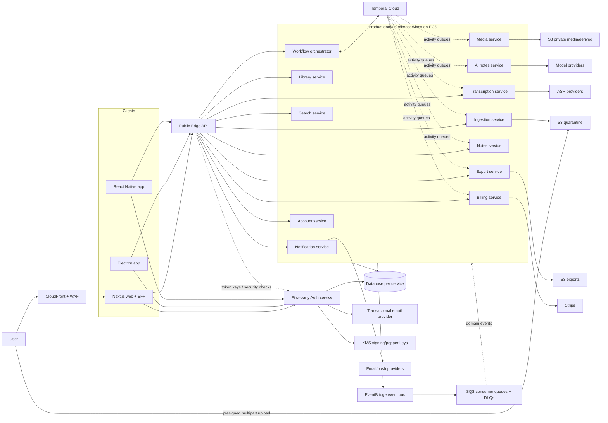
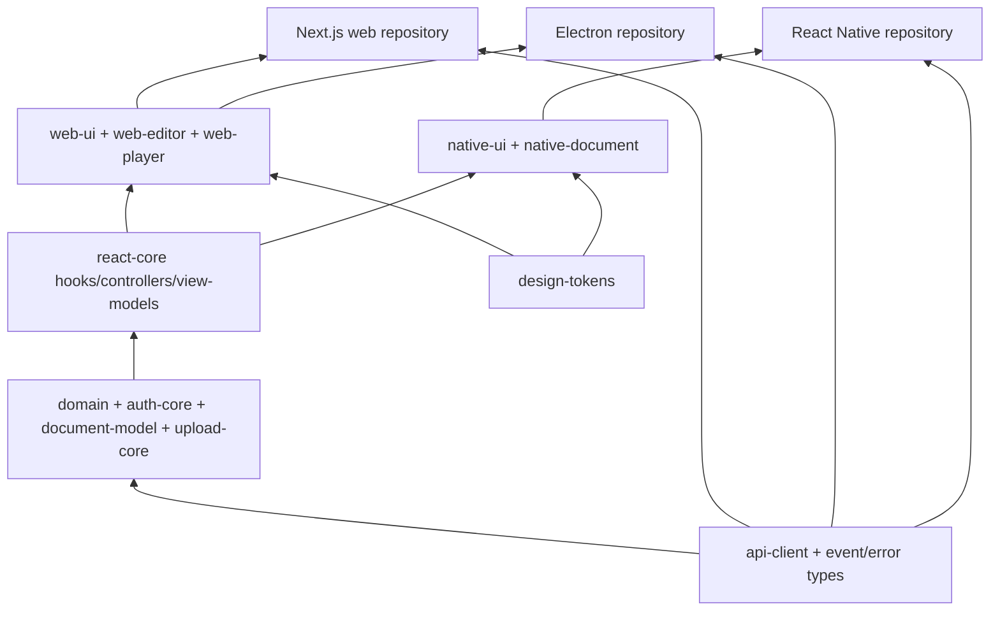
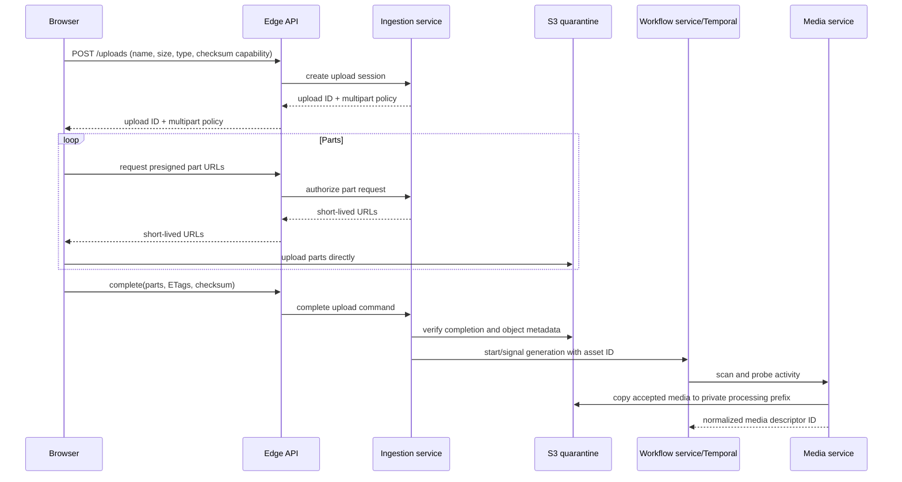
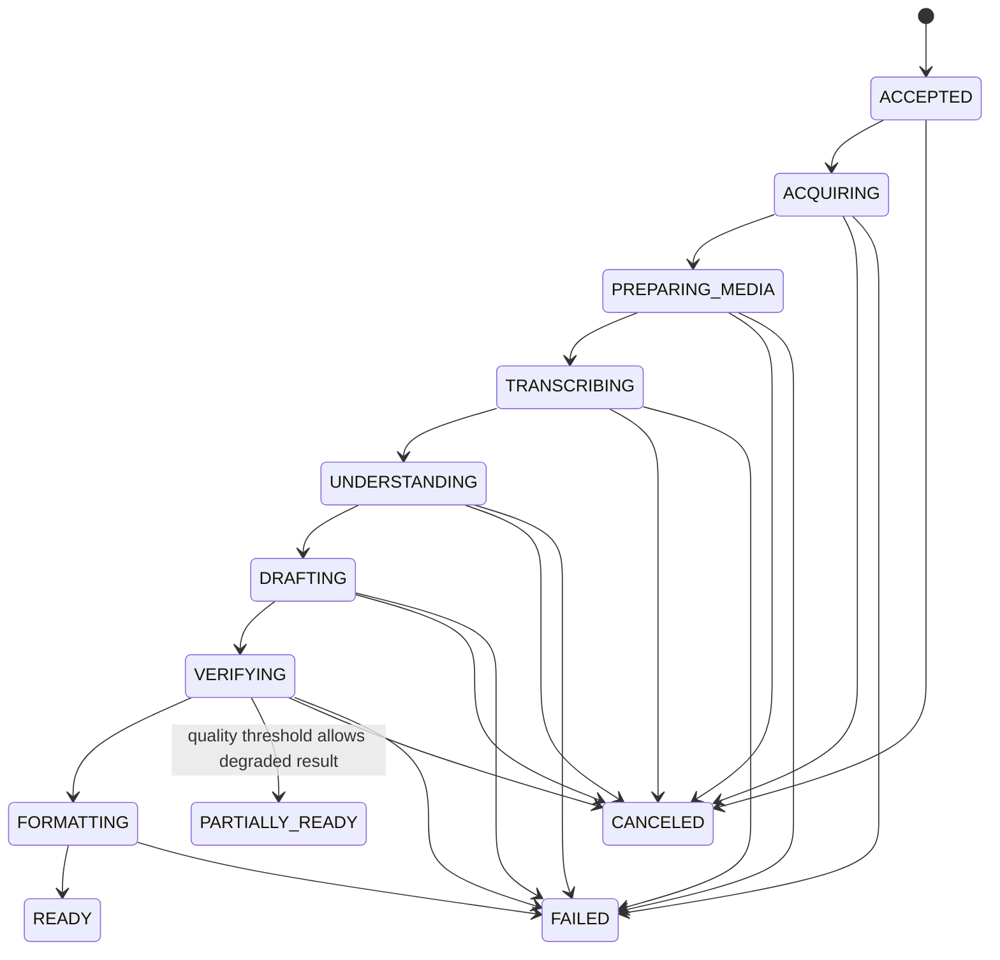

# Technical Requirements Document: Study Notes Creator

**Document status:** Proposed implementation baseline  
**Version:** 0.3  
**Last updated:** 23 November 2026  
**Product requirements:** [PRD.md](./PRD.md)  
**Primary delivery order:** Web, then desktop, then mobile  
**Architecture style:** Polyrepo clients and backend microservices  
**Audience:** Engineering, AI/ML, security, product, design, SRE, and QA

**Revision note:** Version 0.3 adds a first-party Auth Service that owns end-user identity, credentials, verification/recovery, sessions, token issuance/revocation, and signing-key lifecycle. It replaces the managed identity-provider dependency while preserving standards-based OIDC/OAuth flows.

---

## 1. Purpose

This document turns the product requirements into an implementation-ready technical design for the first production version of Study Notes Creator.

The initial system is a responsive web platform. It must accept supported video sources, run a durable media and AI workflow, create timestamp-grounded editable notes, and keep the user’s library synchronized. The design deliberately creates reuse points for a later Electron desktop client and React Native mobile client without forcing the web MVP to carry offline or native-client complexity.

This TRD makes the following primary stack and topology decision:

> Use separate repositories for the Next.js web app, Electron desktop app, React Native mobile app, shared frontend packages, platform contracts, and independently deployable Python/FastAPI backend microservices. Use Temporal for durable cross-service generation workflows.

Python is preferred over Node/Express for backend services because the backend’s defining work is media processing, transcription, structured model orchestration, evaluation, and future ML/vision processing. Each service publishes a typed contract; the public edge contract generates TypeScript clients for all three applications. Frontend reuse happens through private, independently versioned npm packages—not through a single application repository.

---

## 2. Scope

### 2.1 In scope for the web MVP

- Responsive public and authenticated web application.
- First-party authentication and separate product Account lifecycle.
- Local video upload using direct, resumable object-storage upload.
- Approved hosted-video URLs.
- YouTube metadata and embedded playback, with generation only through a rights-compliant source path.
- Durable asynchronous media preparation, transcription, note generation, verification, and export.
- Timestamped transcript and citations.
- Structured rich-text study-note editor with autosave and version safety.
- Library, search, archive, deletion, Markdown/PDF export, feedback, and usage tracking.
- In-app job progress using server-sent events with polling recovery.
- Individual billing foundations.
- Security, privacy, observability, AI evaluation, and deletion workflows.
- Independently deployable backend services with explicit data ownership and failure isolation.
- Independent web, desktop, and mobile repositories consuming versioned shared packages.
- Deployment to a single cloud region with multi-availability-zone managed data services.

### 2.2 Deferred

- Native desktop and mobile releases; their extension paths are specified in Section 8.
- Real-time multi-user editing.
- Source-grounded chat, quizzes, flashcards, and spaced repetition.
- Arbitrary external web research.
- General-purpose browser automation or an open-ended agent tool loop.
- Cross-region active/active deployment.
- Self-hosted foundation models or ASR in the MVP.
- General video hosting or downloadable copies of third-party sources.

---

## 3. Architecture drivers and constraints

### 3.1 Drivers

1. Generation jobs last much longer than an HTTP request and must survive process restarts.
2. Media files are large and must not transit through application servers unnecessarily.
3. Every important note claim must be traceable to source evidence and a timestamp.
4. User edits must never be silently overwritten by regeneration or another device.
5. Model, transcription, and media providers may change; application data must remain portable.
6. Raw media and note content are private and must not leak into logs or general analytics.
7. The product must expose meaningful progress and actionable failures.
8. The web UI should supply reusable TypeScript packages to Electron and, where practical, React Native.
9. YouTube and hosted-source access must comply with provider terms and user rights.
10. Services must be deployable independently without reading or writing another service’s database.
11. Client applications must release independently; shared packages cannot force synchronized releases.
12. The initial team should operate the system without Kubernetes or a large platform group.

### 3.2 Initial sizing envelope

These numbers are engineering assumptions for load testing and cost modeling, not business forecasts:

| Measure | Initial design envelope |
|---|---:|
| Registered users | 10,000 |
| Daily active users | 1,000 |
| Concurrent web sessions | 1,000 |
| Generation jobs per day | 500 |
| Source hours per day | 250 |
| Burst job submissions | 20/minute |
| Maximum source duration | 120 minutes at launch |
| Maximum uploaded file size | 5 GB at launch |
| Typical note document | 50 KB–2 MB JSON |

The architecture scales horizontally beyond this envelope. The limits must remain configuration, plan, and feature-flag values rather than constants embedded in clients.

---

## 4. Technology decisions

### 4.1 Selected stack

| Layer | Selection | Reason |
|---|---|---|
| Web language | TypeScript in strict mode | Client safety and future Electron/mobile reuse |
| Web framework | React with Next.js App Router | Server-rendered public pages, routing, streaming, and a secure web BFF alongside interactive client features |
| Styling and UI | Tailwind CSS, CSS variables, Radix primitives | Accessible primitives, consistent design tokens, and fast responsive development |
| Rich-text editor | Tiptap/ProseMirror with a fixed custom schema | Structured JSON, custom citation nodes/marks, tables, code, formulas, and later Electron reuse |
| Client server-state | TanStack Query | Cache, invalidation, mutation, and offline-aware request state |
| Lightweight client state | Zustand | Player/editor coordination and UI-only state; server data stays in Query |
| Web tests | Vitest, Testing Library, Playwright | Unit, component, accessibility, and browser E2E coverage |
| API language | Python, current supported stable release | Strong media, AI, evaluation, and scientific ecosystem |
| API framework | FastAPI + Pydantic | Typed validation, async I/O, OpenAPI, and generated clients |
| ASGI server | Uvicorn | Production FastAPI serving in horizontally scaled containers |
| Persistence access | SQLAlchemy 2 + psycopg + Alembic | Explicit transactions, async support, and controlled migrations |
| Durable workflow | Temporal Cloud with Python SDK | Durable state, retries, timeouts, cancellation, signals, and observable workflow history |
| Service databases | Managed PostgreSQL, logical database and credentials per service | Transactional service ownership without cross-service table access |
| Object storage | Amazon S3 | Direct multipart upload, lifecycle rules, encryption, and durable media/export storage |
| Domain event bus | Amazon EventBridge with SQS queue per consumer and DLQs | Durable fan-out, consumer isolation, replayable failure handling, and low operational overhead |
| Service discovery | Amazon ECS Service Connect | Private service discovery, traffic metrics, retries, and independently deployed ECS services |
| Ephemeral cache | Managed Valkey/Redis-compatible service | Rate limits and short-lived per-service caches; never the source of truth or cross-service contract |
| Media tools | FFmpeg and ffprobe in isolated worker containers | Format probing, audio extraction, normalization, and optional frame sampling |
| Search | Search service with its own PostgreSQL full-text projection and GIN indexes | Event-driven read model without cross-service database queries |
| Contracts | OpenAPI 3.1, AsyncAPI/JSON Schema, and a dedicated contracts repository | Versioned public/internal APIs, events, generated clients, and compatibility gates |
| Shared frontend code | Private npm packages published from independent repositories | Maximum safe reuse without coupling application releases |
| Authentication | First-party Python/FastAPI Auth Service implementing standards-based OIDC/OAuth 2.1 Authorization Code + PKCE | Product-owned credentials, sessions, recovery, token policy, revocation, and consistent web/desktop/mobile authentication |
| Billing | Stripe Billing and webhooks | Individual subscription and usage-ledger integration |
| Infrastructure | AWS ECS/Fargate, RDS, S3, ElastiCache, CloudFront, WAF; Terraform | Managed primitives without Kubernetes overhead |
| Telemetry | OpenTelemetry plus managed logs/metrics/traces | Cross-service correlation and vendor portability |
| CI/CD | GitHub Actions | Automated validation, container builds, infrastructure plans, and deployments |

Versions must be pinned in lockfiles and container digests. At implementation start, use the latest compatible stable release of each framework and the current active LTS Node.js release. Dependency upgrades run at least monthly; Electron requires a faster security-update cadence after its release.

### 4.2 Why FastAPI instead of Node/Express

FastAPI is the recommended backend for this product.

- Transcription, audio processing, AI provider SDKs, evaluation tooling, and future vision/ML work are strongest and most cohesive in Python.
- Within a service, Pydantic models validate API/event/Activity boundaries and structured model output without sharing ORM/domain code across services.
- The Edge OpenAPI-generated TypeScript client preserves public contract safety across languages and application repositories.
- FastAPI handles concurrent I/O well; CPU-heavy media work runs in independently scaled Media service workers rather than request processes.
- Express would require more choices and conventions for validation, OpenAPI, dependency boundaries, and error handling.
- Keeping backend services in Python avoids splitting one business capability across Node and Python merely for UI-language symmetry.

Reconsider a TypeScript backend only if the product becomes predominantly CRUD/collaboration, the team has no production Python capability, or Python provider support becomes a constraint. If a TypeScript backend is chosen later, prefer a structured framework such as NestJS over unstructured Express routes; keep the OpenAPI and event contracts unchanged.

### 4.3 Why Temporal instead of a simple queue

A queue can deliver a task, but the application would still need to implement durable stage state, retries, cancellation, timeout policy, recovery, and compensation. Temporal provides those workflow semantics directly. It is justified because one generation spans multiple external providers and CPU workers and may run for tens of minutes.

Temporal is used for orchestration only:

- Workflow histories contain identifiers and small state, never media, full transcripts, or note documents.
- All network, database, file, provider, and clock-dependent work occurs in Activities.
- Retry policies are explicit and bounded; the product does not use Temporal’s unlimited default retries.
- Large fan-out uses child workflows or bounded parallel activities.
- A managed Temporal service is preferred initially; self-hosting its control plane is outside MVP scope.

### 4.4 Microservice boundary principles

The backend is decomposed by business capability, not by technical layer or individual endpoint. Every service:

1. Has one owning team, repository, release pipeline, runtime identity, and on-call/runbook.
2. Owns its persistence and is the only component permitted to read or write that data.
3. Publishes versioned APIs/events and does not share ORM models or internal domain packages with another service.
4. Can deploy, scale, roll back, and fail independently within documented dependency limits.
5. Uses an outbox for database-plus-event changes and idempotent consumers for at-least-once event delivery.
6. Exposes health, readiness, metrics, traces, and a machine-readable service version.

Do not create a service for every table or worker function. CPU/IO worker pools can be separate deployment units inside the repository of the service that owns the capability. A new service boundary requires distinct data ownership plus at least one of: independent scaling, security isolation, release cadence, or team ownership.

Cross-service rules:

- No cross-service SQL, shared database credentials, foreign keys, or distributed ACID transactions.
- Synchronous calls are used only when the caller needs an immediate answer; they have strict deadlines, bounded retries, and circuit breakers.
- Domain events communicate completed facts and support eventually consistent projections.
- Multi-service business transactions use a Temporal-orchestrated saga with explicit compensation.
- EventBridge/SQS delivery is at least once; every consumer records processed event IDs or performs naturally idempotent upserts.
- Shared libraries are limited to infrastructure concerns and generated contracts. Business rules remain inside the owning service.

---

## 5. System architecture



### 5.1 Component responsibilities

#### Next.js web and BFF

- Render marketing, authentication, library, settings, and study-workspace routes.
- Hold the browser session in secure, HttpOnly, SameSite cookies.
- Complete Authorization Code + PKCE against the first-party Auth Service and exchange the BFF session for a short-lived API access token server-side.
- Proxy authenticated browser API and event-stream calls; never expose refresh tokens to browser JavaScript.
- Serve responsive UI, upload orchestration, player, editor, and local unsaved-draft recovery.
- Direct upload bytes to S3 rather than through Next.js.

#### First-party Auth Service

- Is the public security-protocol boundary for registration, sign-in, email verification, access recovery, Authorization Code + PKCE, token rotation/revocation, logout, JWKS, and session management.
- Serves a minimal accessible, security-owned registration/sign-in/recovery UI from the Auth repository; prefer server-rendered HTML and minimal JavaScript, reuse approved design-token artifacts, and do not create a separate Auth-UI repository.
- Owns end-user Identity, password/passkey/MFA credentials, verification/recovery challenges, Authentication Sessions, refresh-token families, signing-key metadata, and authentication security audit records.
- Issues short-lived audience-bound access tokens; stores only one-way hashes of passwords, refresh tokens, and one-time challenge tokens.
- Uses KMS/HSM-backed signing and pepper material, overlapping key rotation, refresh-token rotation/reuse detection, rate limits, enumeration-resistant responses, and audited administrative controls.
- Calls Account through an idempotent internal bootstrap contract to obtain the linked `account_id`; Account remains authoritative for profile, preferences, consent, and product lifecycle.
- Does not own Artifacts, Notes, product authorization, Entitlements, or general product notification preferences.

#### Public Edge API

- Is the only public **product API** entry point for desktop/mobile and the web BFF; Auth Service is the separate public authentication-protocol boundary.
- Validates first-party access-token signature, issuer, audience, expiry, scopes, session/security version, and key ID; applies coarse rate limits, propagates identity, and routes or composes calls.
- Publishes the stable public OpenAPI contract used to generate the TypeScript client.
- Exposes job SSE by reading the workflow service’s ordered event stream.
- Contains no domain rules and owns no business database.
- Does not expose internal service topology, provider responses, or internal IDs unnecessarily.

### 5.2 Backend service catalog

| Service/repository | Owns | Persistence | Key contracts |
|---|---|---|---|
| `auth-service` | End-user Identity, credentials, verification/recovery, Authentication Sessions, refresh-token families, token issuance/revocation, signing-key metadata and auth security audit | Auth database + KMS/Secrets Manager + ephemeral rate-limit cache | OIDC/OAuth endpoints, JWKS, session API, internal Account-bootstrap/deletion contracts |
| `account-service` | User profile, preferences, consent, account-deletion request | Account database | Profile API; `AccountDeletionRequested`, `AccountPurged` |
| `library-service` | Artifact aggregate, ownership, title, archive/trash state, current resource references | Library database | Artifact API; `ArtifactCreated`, `ArtifactMetadataChanged`, `ArtifactDeleted` |
| `ingestion-service` | Source validation, upload sessions, provider adapters, media asset registry, retention deadlines | Ingestion database + quarantine/private S3 prefixes | Source/upload API and Temporal activities; `SourceAccepted`, `AssetReady`, `AssetDeleted` |
| `workflow-service` | Temporal generation/deletion sagas, job status, ordered progress events, compensation | Workflow database + Temporal histories | Generation/job API; named Temporal workflows; `GenerationStateChanged` |
| `media-service` | Malware scan, probing, audio extraction, normalization, frame sampling | Media execution database + derived S3 prefix | Temporal activity queue; `MediaPrepared`, `MediaRejected` |
| `transcription-service` | Transcript versions, timed segments, caption/ASR adapters, transcript search source | Transcript database + compressed timing objects | Transcript API/activities; `TranscriptCreated`, `TranscriptDeleted` |
| `ai-notes-service` | Chunking, evidence extraction, outline/draft/verification, quality reports, prompts/config | AI-generation database + temporary S3 intermediates | Temporal activity queue; `NoteDraftReady`, `QualityReportCreated` |
| `notes-service` | Canonical documents, versions, autosave revisions, citations, shares, feedback | Notes database | Notes/share/feedback API and materialization activity; `NoteChanged`, `ShareChanged` |
| `search-service` | User-scoped denormalized search projection and ranking | Search PostgreSQL database | Search API; consumes artifact/note/transcript events |
| `export-service` | Export requests, rendering, file expiry | Export database + export S3 prefix | Export API/activity; `ExportReady`, `ExportFailed` |
| `billing-service` | Subscriptions, entitlements, usage reservation/finalization, Stripe webhooks | Billing database | Billing/usage API and activities; `EntitlementChanged`, `UsageSettled` |
| `notification-service` | In-app/email/push delivery preferences and delivery state | Notification database | Notification API; consumes user-facing domain events |

The service count is a target boundary map, not a requirement to launch fourteen teams. A small team may own several services, but the repositories, data access, deploys, and contracts remain independent.

### 5.3 Communication model

**Synchronous:** Public Edge API to domain services for reads and short commands; service-to-service calls only where the immediate result changes the caller’s response. Use HTTP/JSON with OpenAPI initially through ECS Service Connect. Every call has a deadline, trace context, caller identity, idempotency metadata, and circuit-breaker policy.

**Asynchronous domain events:** Each service commits domain state and an outbox row in one local transaction. Its publisher sends CloudEvents-compatible events to EventBridge. Every consumer has a dedicated SQS queue and dead-letter queue and acknowledges only after its local transaction commits.

Events carry IDs, versions, safe state, and immutable content references—not raw media, transcripts, note bodies, prompts, access tokens, or signed URLs. A consumer needing private content uses its workload identity to call the owner or obtain a narrowly scoped object reference.

**Durable business workflows:** `workflow-service` owns Temporal workflow definitions. Capability services own and run the Activity workers for their task queues. The workflow passes opaque IDs and small results; a service fetches its own data or uses a documented API/object reference. Compensation is explicit and never implemented through direct database rollback in another service.

**Large payloads:** Media, transcripts, draft manifests, and exports move through encrypted S3 objects referenced by immutable IDs and content hashes. Events and Temporal histories do not carry full documents or media.

### 5.4 Consistency model

- The owning service is strongly consistent for its local writes.
- Library, search, notification, and analytics projections are eventually consistent.
- Client mutation responses include authoritative state from the owner; the UI may optimistically update but reconciles with owner revisions.
- The Edge API never performs dual writes to two services.
- Cross-service sagas expose `pending`, `compensating`, `completed`, and `failed` states instead of pretending to be atomic.
- Event consumers tolerate duplication, delayed delivery, stale events, and version gaps. They use `aggregate_version` to ignore stale updates and trigger owner-snapshot reconciliation when a required version is missing. Events carry `event_id`, `event_version`, `aggregate_id`, `aggregate_version`, `occurred_at`, `trace_id`, and `producer`.

---

## 6. Polyrepo organization and governance

There is no application monorepo. Each deployable application or backend service has its own repository, ownership, version, pipeline, and release history. Reuse occurs through published packages and versioned contracts.

### 6.1 Repository inventory

**Client application repositories**

| Repository | Contents |
|---|---|
| `study-notes-creator-web` | Next.js routes, Server Components, browser BFF, web composition, deployment |
| `study-notes-creator-desktop` | Electron main/preload/utility processes, React renderer composition, packaging and updater |
| `study-notes-creator-mobile` | React Native/Expo app, native navigation, platform permissions, store release |

**Shared contract and frontend-library repositories**

| Repository | Published packages |
|---|---|
| `study-notes-creator-contracts` | `@study-notes/api-client`, public OpenAPI, internal API snapshots, event schemas, error/event types |
| `study-notes-creator-frontend-foundation` | `@study-notes/domain`, `auth-core`, `document-model`, `react-core`, `upload-core`, `telemetry`, `design-tokens`, shared TS/ESLint configs |
| `study-notes-creator-web-ui` | `@study-notes/web-ui`, `web-editor`, `web-player`; React DOM packages shared by Next.js and Electron |
| `study-notes-creator-native-ui` | `@study-notes/native-ui`, `native-document`; React Native components and renderer, introduced with mobile |

`study-notes-creator-frontend-foundation` may be a small package monorepo because its output is a set of libraries, not a deployable application. Each package still has its own semantic version and changelog. Keeping the three application repositories separate preserves independent delivery while avoiding a repository for every tiny utility.

**Backend and platform repositories**

```text
study-notes-creator-edge-api
study-notes-creator-auth-service
study-notes-creator-account-service
study-notes-creator-library-service
study-notes-creator-ingestion-service
study-notes-creator-workflow-service
study-notes-creator-media-service
study-notes-creator-transcription-service
study-notes-creator-ai-notes-service
study-notes-creator-notes-service
study-notes-creator-search-service
study-notes-creator-export-service
study-notes-creator-billing-service
study-notes-creator-notification-service
study-notes-creator-ai-evals
study-notes-creator-infrastructure
study-notes-creator-service-template
```

The infrastructure repository owns shared AWS resources, environment composition, service catalog metadata, EventBridge routing, and cross-service dashboards. Each service repository owns its ECS task/service module inputs, alarms, queue/DLQ, database migrations, and runbook; the infrastructure pipeline composes approved service versions.

### 6.2 Shared package publishing

- Publish TypeScript packages to a private npm registry such as GitHub Packages or an organization artifact registry.
- Use scoped names (`@study-notes/*`), semantic versioning, immutable published versions, provenance/signing where supported, and Changesets for release notes.
- Application repositories pin resolved versions in their lockfile. They never consume a Git branch, local filesystem path, submodule, or mutable `latest` tag in production.
- Breaking package changes require a new major version and migration guide. Keep the previous major patched during the documented client support window.
- Canary tags allow a consuming app to test a package before stable promotion.
- Renovate/Dependabot opens package-update pull requests with changelog and compatibility tests.
- Shared packages must be tree-shakeable, declare peer dependencies correctly, and publish ESM/types compatible with Next.js, Electron bundlers, and Metro where applicable.
- React packages declare `react` (and `react-dom` or `react-native` where relevant) as peer dependencies so an application supplies exactly one compatible runtime instance.
- Do not publish secrets, environment configuration, backend SDK credentials, or application-specific routing into shared packages.

### 6.3 Contract ownership and generation

- `edge-api` owns the source public OpenAPI specification; CI publishes an immutable version to `study-notes-creator-contracts` and generates `@study-notes/api-client`.
- A domain service owns its internal OpenAPI and event schemas. Contract publishing validates them into the central registry but does not transfer ownership.
- Event schemas use JSON Schema with a versioned envelope. Breaking event payload changes use a new event type/version; producers support the old version through a migration window.
- Temporal Activity names and request/response payload schemas are published as a small versioned Python contracts package. They contain schemas/constants only—no domain behavior, database models, or service clients.
- Consumer-driven contract tests run in provider CI before deployment. A provider cannot remove a field/endpoint/event version while a supported consumer declares it in use.
- Generated code is never hand-edited. A build fails if generated artifacts differ from the published contract version.

### 6.4 Backend repository template

Each Python service starts from `study-notes-creator-service-template` but copies the template at creation time; it is not permanently coupled to a shared application framework.

```text
service-repository/
├── src/<service>/
│   ├── api/                    # FastAPI transport
│   ├── domain/                 # Service-owned entities and rules
│   ├── application/            # Use cases and ports
│   ├── persistence/            # Service-owned SQLAlchemy mappings
│   ├── events/                 # Event producers/consumers and outbox
│   ├── activities/             # Temporal activities, when applicable
│   ├── providers/              # External adapters
│   └── observability/
├── migrations/                # Only this service's database
├── contracts/                 # Owned OpenAPI/event source schemas
├── tests/
├── deploy/                    # Service Terraform module inputs/manifests
├── Dockerfile
├── pyproject.toml
└── RUNBOOK.md
```

Within every service:

- API and event handlers call application use cases; they do not contain domain rules.
- Domain code does not import FastAPI, SQLAlchemy, Temporal, AWS, or provider SDKs.
- Providers implement service-owned ports.
- Workflows contain no I/O; Activities are idempotent and own external effects.
- Database migrations touch only the service’s database.
- Production containers use multi-stage builds, pinned dependencies, and non-root users.

### 6.5 Cross-repository change workflow

A compatible change flows in this order:

1. Add the new optional contract/package capability and publish a prerelease.
2. Update and release consumers so they tolerate old and new behavior.
3. Deploy the producer/provider change.
4. Observe the compatibility window.
5. Remove the old capability only after usage telemetry shows no supported consumer remains.

Never coordinate a production release by requiring all repositories to merge and deploy at the same moment.

---

## 7. Web frontend design

### 7.1 Routing

Recommended route groups:

```text
/(marketing)                  Public landing, pricing, legal, support
/(auth)                       Sign-in callback and account recovery
/(app)/library                Artifact library
/(app)/new                    Source submission and generation setup
/(app)/artifacts/[artifactId] Study workspace
/(app)/settings               Profile, privacy, billing, notifications
/share/[token]                Revocable read-only artifact view
/bff/v1/*                     Authenticated BFF proxy routes
```

Marketing pages and non-interactive library shells use Server Components where useful. Upload, player, rich editor, job progress, and browser APIs are isolated client components. Do not couple published feature packages to Next.js navigation or server-only APIs.

### 7.2 Frontend reuse architecture

Electron is a desktop runtime, not a separate UI renderer comparable to React Native. Its renderer uses Chromium/React DOM, so web and desktop can share most interactive React components. Next.js-specific routes, Server Components, request/session handling, and image/navigation primitives remain web-only. React Native uses native primitives and therefore shares behavior and contracts rather than DOM components.

Use these reuse layers:

| Layer | Package examples | Web | Electron | React Native |
|---|---|---:|---:|---:|
| Contracts and pure domain | `api-client`, `domain`, error types | Shared | Shared | Shared |
| Authentication behavior | `auth-core` protocol/session types and platform ports | Shared through BFF adapter | Shared through system-browser/keychain adapter | Shared through system-browser/secure-storage adapter |
| Document model | `document-model`, schema validation/migrations | Shared | Shared | Shared |
| State machines and algorithms | upload state, merge logic, formatting, selectors | Shared | Shared | Shared |
| Headless React logic | `react-core` query hooks, controllers, view-models | Shared | Shared | Shared when free of DOM APIs |
| Design language | token source, icons as data, semantic variants | Shared | Shared | Shared token values; native renderer |
| React DOM feature UI | `web-ui`, `web-editor`, `web-player` | Shared | Shared | Not used |
| React Native UI | `native-ui`, `native-document` | Not used | Not used | Shared across iOS/Android |
| App shell | Next.js routes/BFF | Web only | No | No |
| Native shell | Electron main/preload or Expo/native modules | No | Desktop only | Mobile only |

Expected reuse targets—not contractual metrics—are:

- Web ↔ Electron: 80–90% of interactive feature/rendering code after excluding app shell and native integrations.
- Web/Electron ↔ mobile: 60–75% of domain, API, state, validation, document, analytics, and controller code; little direct rendered UI.
- iOS ↔ Android: 90%+ of React Native code, with platform-specific files only where behavior actually differs.

Do not chase a single universal component library if it reduces accessibility or native usability. Reuse stable concepts and behavior first; reuse pixels only where the rendering platform is the same.

React Native Web is not the baseline for this product: the web study workspace depends on DOM-native rich editing, browser media, accessibility, printing, and Next.js rendering, while mobile should use native interaction patterns. It may be evaluated later for simple leaf components, but not as the primary cross-platform abstraction.



Dependency arrows point toward consumers. Application repositories sit at the top of the dependency graph; a shared package must never import an application.

### 7.3 Package responsibilities

**`@study-notes/api-client`**

- Generated public DTOs, error codes, endpoint methods, and SSE event types.
- Accepts an injected transport, base URL, auth/header provider, and retry policy.
- Does not import Next.js, Electron, React Native, browser storage, or a global singleton.

**`@study-notes/domain`**

- Branded IDs, date/duration helpers, generation settings, status mapping, entitlement display types, and pure invariants needed by clients.
- Contains no server-only business decisions and no UI framework imports.

**`@study-notes/auth-core`**

- Shared Auth issuer/client configuration types, coarse scope/session view models, login/logout/revoke state machines, and platform ports.
- Uses an approved maintained OAuth/OIDC client implementation and an injected cryptographic/randomness adapter; it does not implement protocol cryptography itself.
- Does not persist credentials, render the hosted sign-in UI, import application shells, or choose web/native secure storage.
- Web implements the port in the BFF; Electron and React Native use system-browser callbacks and OS secure storage.

**`@study-notes/document-model`**

- Versioned Tiptap-compatible JSON types, schema validation, migrations, citation/provenance types, plain-text projection, and safe traversal utilities.
- Contains no DOM/Tiptap editor runtime. That keeps schema and rendering inputs usable in React Native and backend tooling.

**`@study-notes/react-core`**

- TanStack Query keys/hooks, feature controllers, view-model creation, upload/generation state machines, optimistic update logic, and dependency-injection contexts.
- May depend on React and platform-neutral TanStack packages, but not `window`, `document`, Node/Electron, React DOM, React Native, or Next.js.

**`@study-notes/design-tokens`**

- Semantic color, typography, spacing, radius, elevation, motion, and breakpoint source values.
- Build publishes CSS variables/Tailwind preset for web/Electron and typed token objects for React Native.
- Components use semantic names such as `surface.warning` rather than raw brand hex values.

**`@study-notes/web-ui` / `web-editor` / `web-player`**

- React DOM components, Radix primitives, Tailwind recipes, Tiptap editor, HTML/YouTube player adapters, accessibility behavior, and Storybook.
- Imported by both `study-notes-creator-web` and the Electron renderer.
- Must not import Next.js router, Server Components, server actions, or BFF code. App repositories supply navigation and platform ports.

**`@study-notes/native-ui` / `native-document`**

- React Native components, native navigation bindings, gestures, accessibility, and native document rendering.
- Uses shared tokens and view-models but does not imitate DOM structure.

### 7.4 Platform ports and dependency injection

Shared feature code talks to platform capabilities through narrow interfaces supplied by each application:

```ts
interface PlatformServices {
  auth: AuthAdapter;
  transport: ApiTransport;
  navigation: NavigationAdapter;
  files: FilePickerAdapter;
  uploads: UploadAdapter;
  localState: LocalStateAdapter;
  credentials?: CredentialStoreAdapter;
  notifications: NotificationAdapter;
  downloads: DownloadAdapter;
  sharing: ShareAdapter;
  player: PlayerAdapterFactory;
  telemetry: TelemetryAdapter;
  lifecycle: AppLifecycleAdapter;
}
```

Example implementations:

| Port | Web | Electron | Mobile |
|---|---|---|---|
| Auth | First-party Auth Service + BFF session cookie | First-party Auth Service via system browser PKCE + OS keychain | First-party Auth Service via Expo/system browser PKCE + secure storage |
| Files | Browser file input/File System Access when available | Typed preload IPC and native dialog | Document/photo picker |
| Uploads | Browser multipart + IndexedDB checkpoint | Utility-process multipart + local checkpoint | Native background upload task |
| Local state | IndexedDB for non-secret recovery state | Encrypted SQLite | Local database |
| Credentials | No browser token store; BFF cookie | OS keychain | SecureStore/keychain |
| Navigation | Next.js adapter | React Router or app router adapter | React Navigation adapter |
| Notifications | In-app/SSE, optional web push | Native Electron notification | APNs/FCM through Expo/provider |

Pass `PlatformServices` through an application composition root/React provider. Do not scatter `if (isElectron)` or `Platform.OS` throughout shared features. Small iOS/Android differences live in `.ios.ts(x)`, `.android.ts(x)`, or `.native.ts(x)` modules inside the mobile/native package.

### 7.5 Client data boundaries

- TanStack Query holds API/server state and controls cache invalidation.
- Zustand holds ephemeral UI coordination such as active timestamp, panel layout, and editor toolbar state.
- Tiptap owns the active document transaction state.
- IndexedDB stores only encrypted/session-bound recovery drafts and multipart-upload checkpoints, not durable source truth.
- URL state holds shareable filters and selected workspace mode.
- No server object is duplicated into multiple global stores.

### 7.6 Rich-text editor

Tiptap-compatible JSON is the canonical note document representation. Its pure schema/types live in `document-model`; Tiptap is the web/Electron editing implementation. The schema is versioned and limited to supported nodes and marks:

- Document, paragraph, heading, text, hard break.
- Ordered and unordered lists.
- Blockquote and callout (`definition`, `example`, `warning`, `takeaway`).
- Table, row, header, and cell.
- Inline code and code block with language attribute.
- Formula block and inline formula rendered with KaTeX.
- Link with safe protocol allowlist.
- Citation mark and citation-reference atom.
- Horizontal rule.

Raw HTML is not part of the schema. Pasted content is parsed into supported nodes and sanitized. Each top-level generated node carries a stable `blockId`, origin, generation ID, and last-edit metadata. Citation marks reference citation IDs; they do not embed trusted HTML or raw provider output.

Document schema changes require:

1. A new integer schema version.
2. Forward migration code with fixtures.
3. Read compatibility for the previous two schema versions.
4. Export and web/Electron/mobile renderer tests in their respective repositories.
5. A notes-service database backfill only when lazy migration is insufficient.

### 7.7 Autosave and edit conflicts

- The client debounces saves after 1.5 seconds of inactivity and flushes on navigation/backgrounding where possible.
- `PATCH /notes/{id}` sends the full compressed document for MVP plus `base_revision` and `content_hash`.
- The server applies an optimistic compare-and-swap update and returns the new revision and ETag.
- A stale revision returns `409 NOTE_REVISION_CONFLICT` with the latest metadata, not an automatic overwrite.
- The client first preserves its local draft, then attempts block-level merge using stable `blockId` values.
- If the same block changed on both sides, the user sees a recovery comparison.
- Regeneration always creates a new note version/branch and never mutates the currently edited version.
- CRDT infrastructure is deferred until real-time collaboration is approved.

### 7.8 Playback abstraction

Define a `PlayerAdapter` interface:

```ts
interface PlayerAdapter {
  load(source: PlaybackSource): Promise<void>;
  play(): Promise<void>;
  pause(): Promise<void>;
  seekTo(milliseconds: number): Promise<void>;
  getPosition(): number;
  onPositionChange(listener: (milliseconds: number) => void): () => void;
  onStateChange(listener: (state: PlayerState) => void): () => void;
}
```

Implementations:

- YouTube IFrame Player adapter for YouTube sources.
- HTML media adapter for user-owned media via short-lived signed playback URL.
- Unavailable-source adapter that still allows note reading and shows an external source link.

Citations seek to `start_ms` and highlight the associated transcript span. Playback is never required for reading or exporting a note.

### 7.9 Upload experience

- Browser requests an upload session through Edge after local preflight checks; Ingestion service owns the session.
- Ingestion service returns multipart part size and short-lived presigned part URLs through Edge on demand.
- Browser uploads directly to S3 with bounded concurrency and records upload ID/parts in IndexedDB.
- Pause/resume and page reload recovery are supported for active, unexpired sessions.
- Completion submits part numbers and ETags; Ingestion service verifies object metadata/checksum and signals Workflow service.
- UI derives progress from bytes uploaded, not part count.
- The server never trusts browser MIME type, duration, or file extension.

### 7.10 Accessibility and responsive behavior

- All core workflows meet WCAG 2.2 AA.
- The editor, outline, transcript, player, progress, and citation controls are keyboard navigable.
- Focus returns predictably after dialogs and timestamp actions.
- Desktop-width workspace uses player/outline/document panes; compact layouts use tabs or sheets.
- Reduced motion, high zoom, screen-reader announcements, light/dark themes, and OS text scaling are tested.
- Automated axe checks run in component and E2E tests, supplemented by manual screen-reader testing.

---

## 8. Desktop and mobile extension path

### 8.1 Electron desktop phase

The desktop app is implemented in its own repository after the web product is stable. It packages a local renderer rather than loading the production website as privileged remote content.

- Electron main, preload, and renderer code use TypeScript.
- The renderer consumes published `api-client`, `domain`, `auth-core`, `document-model`, `react-core`, `design-tokens`, `web-ui`, `web-editor`, and `web-player` packages.
- Electron-specific shell code is built with a dedicated renderer toolchain; it does not require a local Next.js server.
- The repository pins package versions and upgrades them through tested dependency pull requests; it never imports source directly from the web repository.
- Authentication uses the system browser and the first-party Auth Service's OIDC Authorization Code + PKCE flow, returning through a validated claimed HTTPS link, custom protocol, or loopback callback as approved per platform.
- Refresh credentials are stored in the OS keychain.
- `nodeIntegration` is disabled, context isolation and sandboxing are enabled, and a strict CSP is applied.
- Preload exposes a minimal typed API; all IPC inputs and sender origins are validated.
- External URLs are allowlisted before opening in the system browser.
- A utility process may continue large file uploads and perform local checksum calculation without blocking the renderer.
- Application updates are signed, staged, and delivered through an authenticated update channel.
- Optional offline reading uses an encrypted local SQLite cache in a later desktop increment; cloud remains the source of truth.

### 8.2 React Native mobile phase

- Build the mobile app in its own repository using React Native, Expo, and TypeScript.
- Consume published `api-client`, `domain`, `auth-core`, `document-model`, `react-core`, `upload-core`, `telemetry`, `design-tokens`, and native UI packages.
- Build native UI rather than attempting to share DOM components.
- Authentication uses the first-party Auth Service through system-browser OIDC with PKCE; refresh credentials use platform secure storage.
- Native background upload support is required before advertising uploads that continue after app termination.
- Initial mobile editing may be block-limited; the full web editor is not placed in a WebView unless a separate security and UX review approves it.
- Read rendering consumes the same versioned Tiptap JSON through a native renderer or a validated intermediate representation.
- Push notifications use platform services through a provider adapter.

### 8.3 Compatibility promise

Web, desktop, and mobile use the same versioned public Edge API and canonical server data. Clients send app version, API-client version, document-schema version, and capability headers. The Edge API supports the current contract and previous released desktop/mobile contracts for the published support window, which must be longer than realistic app-store rollout and desktop auto-update delays.

Package release does not equal app release. A shared-package change is inert until an application explicitly upgrades, tests, builds, and releases it. Emergency server changes must degrade gracefully for older supported clients through capability negotiation rather than forcing a synchronized client deployment.

---

## 9. API design

### 9.1 Conventions

- JSON REST API under `/v1`.
- Public OpenAPI 3.1 is published by Edge API; each domain service separately publishes its internal OpenAPI.
- UUIDv7 identifiers serialized as strings.
- UTC timestamps in RFC 3339 format.
- Cursor pagination with stable sort keys; no unbounded list endpoints.
- `Idempotency-Key` is required for job creation, upload completion, export creation, and billing-affecting mutations.
- ETag/revision headers protect note updates.
- Request and trace IDs are returned on every response.
- No API returns internal object-store keys, provider credentials, raw stack traces, or model prompts.
- Clients call only Edge API. Internal service endpoints are private, independently authenticated, and never generated into the frontend client.
- Domain events use versioned JSON Schema/AsyncAPI definitions and CloudEvents-compatible envelopes.

Standard error shape:

```json
{
  "error": {
    "code": "SOURCE_NOT_ACCESSIBLE",
    "message": "This source cannot be accessed.",
    "retryable": false,
    "details": {},
    "request_id": "019..."
  }
}
```

`message` is user-safe. `code` is stable and drives client behavior. `details` has a schema per code and contains no secret or raw exception.

### 9.2 Primary public endpoints

Edge API exposes these paths while routing to or composing from the listed owner. Composition must remain bounded; complex projections belong in a read-model service.

| Method and path | Owning service | Purpose |
|---|---|---|
| `POST /v1/sources/validate` | Ingestion | Validate URL, return metadata and supported acquisition paths |
| `POST /v1/uploads` | Ingestion | Create multipart upload session |
| `POST /v1/uploads/{id}/parts` | Ingestion | Issue presigned URLs for requested part numbers |
| `POST /v1/uploads/{id}/complete` | Ingestion | Verify and complete multipart upload |
| `DELETE /v1/uploads/{id}` | Ingestion | Abort an upload session |
| `POST /v1/artifacts` | Library | Create artifact aggregate with a source reference |
| `GET /v1/artifacts` | Library/Search | Search/filter cursor-paginated library projection |
| `GET /v1/artifacts/{id}` | Library read model | Get composed workspace metadata |
| `PATCH /v1/artifacts/{id}` | Library | Rename/archive/update supported metadata |
| `DELETE /v1/artifacts/{id}` | Workflow + Library | Start recoverable deletion saga |
| `POST /v1/artifacts/{id}/generations` | Workflow | Reserve usage and start a generation saga |
| `POST /v1/generations/{id}/cancel` | Workflow | Request workflow cancellation |
| `POST /v1/generations/{id}/retry` | Workflow | Start a new run from valid retained inputs |
| `GET /v1/jobs/{id}` | Workflow | Get current job state and progress |
| `GET /v1/jobs/{id}/events` | Workflow via Edge | SSE stream; resumes using event sequence/Last-Event-ID |
| `GET /v1/artifacts/{id}/transcript` | Transcription | Page/search permitted transcript segments |
| `GET /v1/notes/{id}` | Notes | Fetch note JSON and revision |
| `PATCH /v1/notes/{id}` | Notes | Optimistic autosave update |
| `GET /v1/notes/{id}/versions` | Notes | List recoverable versions |
| `POST /v1/notes/{id}/restore` | Notes | Create current version from an earlier version |
| `POST /v1/artifacts/{id}/exports` | Export | Start Markdown/PDF export |
| `GET /v1/exports/{id}` | Export | Get status and short-lived download URL |
| `POST /v1/artifacts/{id}/feedback` | Notes | Submit artifact/block/timestamp feedback |
| `POST /v1/artifacts/{id}/shares` | Notes | Create revocable read-only share |
| `DELETE /v1/shares/{id}` | Notes | Revoke share |
| `GET /v1/usage` | Billing | Return allowance, reservations, and ledger summary |
| `POST /v1/billing/checkout` | Billing | Create hosted checkout session |
| `POST /v1/webhooks/stripe` | Billing, private route | Verify and process Stripe webhook |
| `GET /v1/me` | Account | Current user and preferences |
| `DELETE /v1/me` | Workflow + Account | Start account deletion saga |

Auth Service is exposed on a dedicated first-party authentication origin. These protocol/security routes are not part of Edge's product `/v1` API:

| Method and path | Owner | Purpose |
|---|---|---|
| `GET /.well-known/openid-configuration` | Auth | OIDC discovery metadata |
| `GET /.well-known/jwks.json` | Auth | Current and overlapping public signing keys |
| `GET /oauth/authorize` | Auth | Authorization Code + PKCE authorization endpoint and hosted sign-in/registration UI |
| `POST /oauth/token` | Auth | Authorization-code exchange and rotating refresh-token grant |
| `POST /oauth/revoke` | Auth | Revoke refresh-token family/session |
| `POST /auth/register` | Auth | Create an Identity and start email verification without leaking existing-account state |
| `POST /auth/verify-email` | Auth | Consume a single-use verification challenge |
| `POST /auth/recovery/request` | Auth | Start enumeration-resistant access recovery |
| `POST /auth/recovery/complete` | Auth | Consume a single-use recovery challenge and revoke prior sessions |
| `GET /auth/sessions` | Auth | List the Actor's active Authentication Sessions |
| `DELETE /auth/sessions/{id}` | Auth | Revoke one Authentication Session/token family |

Credential submission and refresh-token rotation go directly to Auth Service over TLS; Edge and domain Services never receive a password or refresh token.

### 9.3 Idempotency

- The owning command service stores a hash of user, operation, idempotency key, and normalized request body in its database; Edge forwards the key unchanged.
- Reuse of the same key and same body returns the stored response.
- Reuse with a different body returns `409 IDEMPOTENCY_KEY_REUSED`.
- Generation workflow ID is `generation/{generation_id}` and cannot be started twice.
- Every billing ledger mutation has a unique business-event key.
- Webhook event IDs have a unique constraint.
- Every event consumer records `(consumer, event_id)` or uses a domain-specific unique key before applying side effects.
- Activity results use deterministic stage keys in the owning service where replay could otherwise duplicate a database write.

---

## 10. Authentication and authorization

### 10.1 Identity and Account boundary

- Auth Service owns the security principal (`identity_id`), login identifiers, credentials, verification/recovery, Authentication Sessions, token families, token issuance/revocation, signing keys, and authentication security audit.
- Account Service owns `account_id`, profile, product preferences, consent, and product Account deletion request/state.
- One Auth Identity initially maps to one Account. Account owns the canonical `identity_id` → `account_id` relationship; Auth stores the returned `account_id` as a minimal token-claim projection.
- After email verification, Auth calls Account's idempotent private `CreateAccountForIdentity` Command. Until this succeeds, the Identity is `pending_account` and cannot obtain normal product scopes.
- Repair/reconciliation retries Account bootstrap by `identity_id` without creating duplicate Accounts.
- Deleting an Account immediately revokes Auth Sessions, then the Deletion Saga purges both Services under their own retention policies.

### 10.2 Authentication flows

**Web:**

1. Next.js redirects to the first-party Auth Service's `/oauth/authorize` endpoint using Authorization Code + PKCE, state, nonce, and an exact registered redirect URI.
2. Auth renders its own registration/sign-in/verification/recovery UI and never sends credentials through Edge or the web application.
3. The authorization code is short-lived, one-time, client-bound, redirect-bound, and exchanged by the BFF.
4. The BFF stores only an opaque/encrypted rotating web-session reference in `Secure`, `HttpOnly`, `SameSite=Lax` cookies; server-side session material/refresh tokens are inaccessible to browser JavaScript.
5. The BFF obtains a short-lived audience-bound access token and calls Edge API.

**Desktop/mobile:**

1. The client opens the first-party Auth Service in the system browser using Authorization Code + PKCE, state, nonce, and a platform-approved redirect.
2. Auth returns a one-time code through a claimed HTTPS/universal link or another reviewed callback mechanism.
3. The client exchanges the code directly with Auth Service.
4. Rotating refresh credentials live only in OS secure storage; access tokens remain in memory where practical.
5. Edge accepts the same short-lived issuer/audience-bound access-token format as web.

**Access token:**

- Signed JWT with `sub=identity_id`, `account_id`, audience, issuer, scopes, `session_id`/security version, issued/expiry time, unique `jti`, and key ID.
- Contains no email, display name, password state, private content, Entitlement ledger, or unnecessary profile data.
- Edge validates locally from cached Auth JWKS. Resource Services receive a signed short-lived internal Actor context and still authorize the resource.

### 10.3 Credential, token, and session security

- Password credentials are processed only by Auth. Password hashes use Argon2id with per-credential salt and benchmarked memory/time parameters; pepper material is versioned in KMS/Secrets Manager, never the Auth database.
- Use mature, actively maintained OAuth/OIDC, JOSE/JWT, WebAuthn, password-hashing, and constant-time cryptographic libraries. Do not design custom cryptographic primitives or hand-roll protocol parsing.
- Registration, sign-in, verification, and recovery responses are enumeration-resistant and protected by WAF, per-IP/identifier/device throttles, progressive delay, bot controls, and security telemetry.
- Verification/recovery codes are cryptographically random, stored only as keyed hashes, purpose/audience bound, single use, short lived, and invalidated on successful use or superseding request.
- Refresh tokens are opaque, high-entropy, one-time rotating tokens stored only as hashes. Reuse revokes the token family, raises a security audit event, and requires reauthentication.
- Access tokens are deliberately short lived. Logout/revocation blocks refresh immediately; high-risk Account/Billing/security operations may require a private Auth session-status check so they do not rely only on JWT expiry.
- Signing private keys remain in KMS/HSM-backed custody. JWKS publishes current/overlapping public keys; rotation preserves validation through the maximum issued-token lifetime and supports emergency revocation.
- Auth Sessions record bounded device/user-agent/IP security metadata under the approved retention policy. Users can list and revoke sessions without exposing token material.
- Password changes/recovery revoke older token families. Sensitive security changes require recent authentication and, where enabled, MFA.
- Auth owns passkey/WebAuthn and MFA credential records when introduced. Initial launch method scope and MFA requirements are decided in ADR-009; no external identity provider becomes authoritative.
- Transactional verification/recovery/security email may use an external delivery provider, but Auth owns challenge state, message intent, security policy, and verification result. The provider is only a delivery processor.
- Social/federated login is outside the initial scope. If added later, first-party Auth remains issuer and broker; the external identity is not exposed as the product Account.

### 10.4 Authorization

- Every user-owned aggregate includes `owner_account_id`; future team-owned aggregates additionally include `workspace_id`.
- Edge validates the user token, but each domain service independently authorizes the propagated actor and requested resource. Edge authentication is not sufficient authorization.
- Service-to-service requests use workload identity through ECS/IAM and mTLS where configured. The signed internal identity includes caller service, original actor, scopes, trace ID, and a short expiry.
- PostgreSQL row-level security is enabled on high-risk user-content databases where it improves defense in depth; policies and roles are local to the owning service.
- Each service has distinct runtime, migration, outbox-publisher, and read-only support credentials. No credential grants another service’s database access.
- Temporal Activity workers use the identity of their owning capability service and are scoped to their task queue and storage prefixes.
- Support staff see job metadata by default, not transcript/media/note contents.
- Content access for an approved support investigation requires an audited, time-limited elevation path.
- Share tokens contain at least 192 bits of randomness; only a keyed hash is stored.
- Share access never grants source download or private transcript access unless a future explicit permission adds it.

---

## 11. Source ingestion and media pipeline

### 11.1 Source adapter contract

```python
class SourceAdapter(Protocol):
    async def validate(self, locator: str, actor: Actor) -> SourceMetadata: ...
    async def acquisition_options(self, source: Source) -> list[AcquisitionOption]: ...
    async def acquire(self, source: Source, option: AcquisitionOption) -> AcquiredSource: ...
    def playback_descriptor(self, source: Source) -> PlaybackDescriptor: ...
```

Adapters are provider-specific and feature-flagged. Validation and acquisition are separate: being able to show metadata or embed a video does not imply permission to copy audio or captions.

### 11.2 Local upload



Requirements:

- Upload session belongs to one user and artifact and expires after 24 hours of inactivity.
- Presigned URLs expire within 15 minutes and are limited to a specific bucket, key, part, checksum, and content length where supported.
- Object keys use generated IDs, never raw user paths.
- Quarantine bucket cannot be read by web/Edge runtime identities; only scoped ingestion/media identities can access it.
- Completion verifies size and checksum before the object is accepted.
- Malware scanning and `ffprobe` run before any general processing.
- File extension and browser MIME are hints only.
- Unsupported or suspicious files are quarantined, marked failed, and removed by lifecycle policy.

### 11.3 Hosted video URL

- MVP supports an allowlist of providers or direct-media hosts approved by product/legal/security.
- URLs must use HTTPS.
- DNS is resolved and checked against private, loopback, link-local, multicast, metadata-service, and reserved ranges before every connection and redirect.
- Redirect count, response size, duration, bandwidth, and request time are capped.
- Credentials embedded in URLs are rejected.
- The fetcher uses a dedicated egress identity and cannot reach internal services.
- `Content-Type` and `Content-Length` are not trusted without probing.
- Signed URLs must remain valid long enough to acquire the object; otherwise the user is asked to upload.
- The user attests they have processing rights before acquisition.

### 11.4 YouTube

YouTube integration is split into three independent capabilities:

1. Metadata through an approved API.
2. Playback through the official embedded player.
3. Transcript/media acquisition only through a method explicitly permitted by YouTube terms and the user’s rights.

The system must not scrape, download, or separate audio from a public YouTube URL merely because it is publicly viewable. Official caption download commonly requires authorization and sufficient rights. If a compliant transcript/acquisition path is unavailable, source validation returns `NEEDS_AUTHORIZED_SOURCE` and asks the user to provide a file or transcript they are authorized to process.

`YouTubeSourceAdapter` therefore has a compliance feature flag. No extractor is merged or enabled until legal review documents the approved method, scopes, retention, attribution, and player behavior. This is a public-MVP launch gate because the PRD lists YouTube URL ingestion as P0.

### 11.5 Media processing

Accepted media proceeds through:

1. Malware and container scan.
2. `ffprobe` validation of streams, codecs, duration, and audio presence.
3. Resource estimate and hard limit check.
4. Audio extraction to a provider-appropriate mono format and sample rate.
5. Loudness normalization only when benchmark results show a transcription benefit.
6. Optional scene-change/frame sampling behind a P1 feature flag.
7. Temporary-object registration with deletion deadline.

FFmpeg runs as a non-root process in an isolated container with read-only base filesystem, scratch volume quota, seccomp/AppArmor-equivalent restrictions, disabled inbound networking, constrained egress, and hard CPU/memory/time limits. Media failures map to stable user-safe error codes.

---

## 12. Durable generation workflow

### 12.1 Workflow state machine



Job state is monotonic within a generation attempt. Retrying creates a new generation ID linked to the earlier attempt; it does not move `FAILED` back to an active state.

### 12.2 Workflow activities

`GenerateStudyNotesWorkflow` is defined by workflow-service; capability services implement the named Activities on their own task queues:

| Order | Activity | Owning service |
|---:|---|---|
| 1 | `reserve_usage` | Billing |
| 2 | `resolve_and_acquire_source` | Ingestion |
| 3 | `scan_and_probe_media` | Media |
| 4 | `prepare_audio` | Media |
| 5 | `obtain_or_create_transcript` | Transcription |
| 6 | `normalize_transcript` | Transcription |
| 7 | `build_semantic_chunks` | AI notes |
| 8 | `extract_evidence` in bounded parallel batches | AI notes |
| 9 | `plan_outline` | AI notes |
| 10 | `draft_sections` in bounded parallel batches | AI notes |
| 11 | `assemble_document` | AI notes |
| 12 | `verify_grounding_and_citations` | AI notes |
| 13 | `run_quality_gate` | AI notes |
| 14 | `repair_document` at most once | AI notes |
| 15 | `materialize_note_version` | Notes |
| 16 | `set_current_note_reference` | Library |
| 17 | `finalize_usage` | Billing |
| 18 | `schedule_temporary_asset_cleanup` | Ingestion/Media |

`GenerationReady` is published after materialization and usage settlement; notification-service consumes it. User notification is not on the critical path to the durable ready state.

Cancellation runs compensation for unused reservation, incomplete uploads, and temporary derivatives. A finalization guard ensures usage is either committed or released exactly once.

### 12.3 Retry policy

| Failure class | Example | Policy |
|---|---|---|
| Transient dependency | Timeout, provider 5xx | Exponential backoff with jitter, capped attempts and elapsed time |
| Rate limit | Provider 429 | Honor retry hint, route to rate-limited queue, bounded deadline |
| Invalid source | No audio, corruption | Non-retryable; actionable user error |
| Invalid model schema | Malformed structured response | One schema-repair attempt, then provider/model fallback if configured |
| Quality failure | Insufficient evidence coverage | One bounded repair; otherwise partially ready or failed by policy |
| Internal bug | Invariant violation | Non-retryable for the run; alert with trace ID |
| Cancellation | User request | Cooperative cancellation plus compensation |

Every Activity defines start-to-close, schedule-to-close, and heartbeat timeouts appropriate to its work. Media and long provider activities heartbeat progress. Workflow code pins/version-gates behavior so deployments do not break replay.

An unavailable capability service causes the Activity task to remain/retry within its deadline without corrupting another service’s state. The workflow-service repository carries compatibility tests for every supported Activity-contract version. Capability services must deploy backward-compatible workers before workflow-service schedules a new Activity version.

### 12.4 Progress

- Stage weights are server configuration derived from historical duration by source type and preset.
- Progress never moves backward within an attempt and caps at 95% until the note transaction commits.
- Workflow service owns `job_events` with an increasing per-job sequence, stage, safe message code, progress, and timestamp.
- Workflow code records an Activity completion, then a workflow-service Activity commits the corresponding job projection and outbox event idempotently.
- The outbox publishes `GenerationStateChanged` to EventBridge. Edge SSE receives live updates through a workflow-service stream/cache adapter; EventBridge is not exposed directly to clients.
- On reconnect, `Last-Event-ID` replays missed events from the workflow database before live subscription.
- Polling `GET /jobs/{id}` through Edge is the fallback; workflow service remains the source of truth.

### 12.5 Task queues and scaling

Use separate Temporal task queues:

- `orchestration`
- `ingestion.activities.v1`
- `media.activities.v1`
- `transcription.activities.v1`
- `ai-notes.activities.v1`
- `notes.activities.v1`
- `billing.activities.v1`
- `export.activities.v1`
- `cleanup.activities.v1`

Each queue is polled only by workers deployed from its owning service repository. Worker pools scale independently from queue latency/backlog, provider quotas, CPU, and memory. Concurrency limits exist globally and per provider. A user/plan concurrency policy prevents one account from monopolizing workers.

---

## 13. AI and transcription design

### 13.1 Provider abstraction

AI/transcription service-owned interfaces prevent provider response objects from entering domain or persistence models:

```python
class TranscriptionProvider(Protocol):
    async def transcribe(self, audio: AudioAsset, options: ASROptions) -> TranscriptResult: ...

class TextModelProvider(Protocol):
    async def generate_structured(
        self,
        request: ModelRequest,
        response_type: type[BaseModel],
    ) -> ModelResult: ...

class VisionModelProvider(Protocol):
    async def analyze_frames(self, frames: list[Frame], task: VisionTask) -> VisionResult: ...
```

Provider selection is configuration keyed by environment, task type, language, preset, and experiment assignment. A provider change requires benchmark and cost results, not only anecdotal output.

### 13.2 Transcript representation

The normalized transcript contains:

- Transcript version and language.
- Ordered segments with stable IDs.
- Start/end milliseconds.
- Text.
- Speaker label when available and useful.
- Provider confidence where meaningful.
- Word timing in compressed object storage when available; segment timing in the transcription-service database.
- Source type: authorized captions, ASR, or corrected.

Segments are immutable within a transcript version. Corrections create a new transcript version and invalidate derived generation inputs by version reference.

### 13.3 Chunking and evidence extraction

- Normalize punctuation and obvious ASR artifacts without changing meaning.
- Create semantically coherent chunks targeting a configurable token range, preserving exact segment IDs and time bounds.
- Small overlaps may provide context, but duplicated evidence is collapsed by source span.
- Run structured extraction per chunk to produce `EvidenceItem` objects such as definition, claim, procedure, example, formula/code reference, caveat, transition, and ambiguity.
- Every evidence item references transcript segment IDs and exact time bounds.
- The model may classify or paraphrase evidence but cannot create a source citation timestamp directly.

### 13.4 Planning and drafting

1. Outline planning consumes compact evidence summaries, generation settings, and source metadata.
2. Each outline section lists the evidence IDs it is allowed to use.
3. Section drafting receives only its evidence and nearby context.
4. Structured section output contains Tiptap-compatible content plus cited evidence IDs.
5. The assembler converts evidence IDs to immutable citation records and rejects unknown IDs.
6. Global synthesis creates overview and takeaways only from already accepted evidence.

This evidence-first approach makes citations a data relationship rather than a timestamp invented in prose.

### 13.5 Grounding and quality checks

Deterministic checks:

- All citation/evidence IDs exist and belong to the same source/transcript version.
- Time bounds are ordered and within source duration.
- Required document nodes conform to the schema.
- No unsupported URL or raw HTML is present.
- Coverage exists across major outline sections.
- Citation density meets the preset policy.
- Direct quotation length stays within product policy.

Model-assisted checks:

- Each material claim is entailed or reasonably supported by cited evidence.
- The note preserves qualifications and does not convert opinion into fact.
- Important source topics are not missing.
- Audience level and output language are correct.
- Examples added by the model are clearly marked as generated explanations.

The verifier produces a typed `QualityReport` with dimension scores, defect records, and repair instructions. One repair pass is allowed. A report is stored with model/prompt/configuration versions for evaluation; raw chain-of-thought is never requested or stored.

### 13.6 Bounded “agentic” behavior

- The workflow graph is application-defined and versioned.
- The model can propose an outline and repair content but cannot add tools or workflow stages.
- External browsing is disabled for MVP.
- Model calls cannot access secrets, the network, other artifacts, or arbitrary files.
- Transcript and frames are wrapped and labeled as untrusted source data.
- Instructions inside source content never override system policy.
- Each generation has maximum calls, input/output tokens, provider spend, wall time, and repair count.
- Exceeding a budget produces a controlled partial/failure outcome and alerts if anomalous.

### 13.7 Prompt and model lifecycle

- Prompt templates live in source control with semantic IDs and immutable versions.
- Production records prompt version, model/provider version, sampler settings, schema version, evaluation cohort, token usage, latency, and cost.
- Logs contain hashes/IDs and metrics, not full prompts or responses.
- Provider request/response retention is disabled where the provider supports it and contracts require it.
- Model changes pass offline regression, shadow/canary evaluation, and rollback criteria.
- A kill switch can disable a provider, language, source adapter, or generation preset without deployment.

---

## 14. Canonical document, citations, and provenance

### 14.1 Note version

Each note version stores:

- `schema_version`
- Tiptap `document_json`
- `content_hash`
- monotonically increasing artifact revision
- parent note version, if any
- generation ID or user origin
- source transcript version
- generation settings snapshot
- created-by actor and timestamp
- quality report ID

Generation creates immutable versions. The artifact points to the current editable version. Autosave updates the working version through optimistic concurrency while periodic checkpoints create immutable recovery snapshots.

### 14.2 Citation record

```text
Citation
  id
  artifact_id
  transcript_version_id
  start_ms
  end_ms
  transcript_segment_ids[]
  evidence_item_id
  evidence_text_hash
  confidence
  created_by_generation_id
```

The client resolves a citation ID to safe display text and playback time from the API. If the user materially changes cited text, the editor marks the citation as user-modified/stale until the user removes it or a future re-verification succeeds. User editing never silently asserts that new prose was said in the source.

### 14.3 Provenance states

Blocks or spans can have these origins:

- `source_grounded_ai`
- `ai_explanation` (not directly present in source)
- `user`
- `mixed`

Provenance is presentation metadata, not a security boundary. Notes service validates the document schema, citation manifest, actor, and artifact reference on every save.

---

## 15. Data model

### 15.1 Service-owned data

| Service database | Core tables/projections |
|---|---|
| Auth | `identities`, `login_identifiers`, `password_credentials`, `verification_challenges`, `recovery_challenges`, `authentication_sessions`, `refresh_token_families`, `authenticators`, `signing_key_metadata`, `auth_security_events`, local outbox/processed events |
| Account | `users`, `user_preferences`, `consents`, `account_deletion_requests`, local `outbox_events`/`processed_events` |
| Library | `artifacts`, `artifact_resource_refs`, `trash_records`, artifact status/read projection, local outbox/processed events |
| Ingestion | `sources`, `media_assets`, `upload_sessions`, `retention_tasks`, provider metadata, local outbox/processed events |
| Workflow | `generations`, `job_events`, `workflow_bindings`, compensation state, local outbox/processed events |
| Media | `media_executions`, `scan_results`, `derived_assets`, local outbox/processed events |
| Transcription | `transcript_versions`, `transcript_segments`, speaker/word-timing references, local outbox/processed events |
| AI notes | `evidence_items`, `quality_reports`, prompt/config references, temporary generation manifests, provider cost records |
| Notes | `note_versions`, `note_checkpoints`, `citations`, `feedback`, `share_links`, flattened note text, local outbox/processed events |
| Search | `artifact_search_documents`, `transcript_search_documents`, event checkpoints, rebuild metadata |
| Export | `exports`, `render_attempts`, local outbox/processed events |
| Billing | `subscriptions`, `entitlements`, `usage_reservations`, `usage_ledger`, webhook receipts, local outbox/processed events |
| Notification | `notifications`, `delivery_preferences`, `delivery_attempts`, device tokens, processed events |

All cross-service references are opaque IDs plus the minimum immutable snapshot/hash needed by the consumer. They are not database foreign keys. For example, a notes citation stores `transcript_version_id`, segment IDs, time bounds, and evidence hash received in a versioned materialization manifest; Notes service does not query transcript tables directly.

### 15.2 Database rules

- Each service’s PostgreSQL database is authoritative only for that service’s aggregates.
- Initially, logical databases may share a managed PostgreSQL cluster to control cost, but each service uses a separate database, role, migration history, backup/restore test, and network secret. Cross-database queries, foreign data wrappers, and shared tables are prohibited.
- Foreign keys and check constraints enforce relationships only inside a service boundary.
- Cross-service integrity is maintained through owner validation, versioned IDs, events, reconciliation jobs, and workflow compensation.
- Soft deletion makes the user-facing trash window possible; purge workflows perform physical deletion.
- PII and user content are not duplicated into analytics tables.
- Note JSONB is validated by Notes service and checked against `schema_version`.
- Frequently queried fields are relational columns, not buried in JSONB.
- Every event-producing service has its own transactional outbox; every consumer has a processed-event/idempotency mechanism.
- Schema changes and migrations are deployed by the owning service only.
- Vector storage is deferred until grounded Q&A or semantic search has a measured requirement.
- Migrations are forward-only in production; destructive changes use expand/migrate/contract releases.

---

## 16. Search

Search service owns a PostgreSQL full-text projection populated from versioned Library, Notes, and Transcription domain events:

- Artifact title and source metadata.
- Flattened current-note text.
- Permitted transcript segment text.
- Prefix/fuzzy title matching using an appropriate PostgreSQL extension if enabled.

Events announce a new content version/reference but do not contain private note/transcript text. Search service obtains the indexable snapshot from the owning service through an authenticated internal API or narrowly scoped object reference, then records the source version in its projection.

Its `tsvector` columns use GIN indexes. Search rows include owner/workspace and deletion state, and queries always apply authorization scope before ranking. Search results return artifact-level hits plus a bounded list of snippets. Edge/Notes do not expose a private transcript through a share link unless share scope explicitly permits it.

Projection updates are eventually consistent. Search service exposes index lag and supports a full rebuild by replaying owner-service export/event snapshots. If measured ranking, typo-tolerance, or corpus requirements exceed PostgreSQL, change the search service’s internal engine without changing the public API or data ownership.

---

## 17. Export and sharing

### 17.1 Export

- Export is asynchronous and pinned to a specific note version.
- Markdown conversion is deterministic from the canonical document schema.
- Citation links include source attribution and timestamp URLs when the provider supports them.
- PDF uses sanitized server-rendered HTML, embedded approved fonts, print CSS, and no external network requests.
- Export files are private, encrypted, and deleted after 24 hours; they can be regenerated.
- Download URLs expire within 15 minutes.
- Export workers have no access to unrelated users’ content.

### 17.2 Read-only shares

- Share creation records the exact artifact/current-note scope.
- The public token appears only in the URL; a keyed token hash is stored.
- Share pages apply restrictive CSP, `noindex`, referrer policy, and rate limiting.
- Owner can revoke immediately.
- Private source media is not proxied to anonymous viewers by default.
- User edits appear on the share only if the share targets “current version”; a fixed-version option may be added later.

---

## 18. Billing and usage accounting

- Billing service estimates units from source duration, depth, and enabled modalities before generation.
- Workflow service first persists a `PENDING_START` generation plus a local start-outbox record. Its dispatcher starts the Temporal workflow idempotently; the workflow’s first capability step requests the Billing reservation. A reservation failure ends the generation safely, and later failures invoke compensation. There is no cross-service transaction.
- Workflow completion calls an idempotent settlement Activity; product-caused failure or cancellation releases unused units according to policy.
- Ledger rows are append-only; corrections are compensating entries.
- Stripe webhooks update subscription/entitlement state through idempotent handlers.
- Billing service’s internal usage ledger, not a client response or webhook delivery order, is the source of truth for generation entitlement.
- Provider cost is recorded per Activity and aggregated per generation without exposing provider token terminology to the user.
- Hard per-job and per-user daily cost caps limit abuse and runaway agent loops.

---

## 19. Data retention and deletion

Recommended launch defaults, subject to legal/product approval:

| Data | Retention |
|---|---|
| Incomplete multipart upload | Abort after 24 hours inactive |
| Rejected/quarantined source | Delete within 24 hours |
| Uploaded raw video | Delete within 24 hours after terminal generation state |
| Extracted audio and sampled frames | Delete within 24 hours after terminal state |
| Temporary AI intermediates | Delete within 7 days; sooner where practical |
| Transcript and note | Until user deletes artifact/account |
| Generated export | 24 hours |
| Recoverable deleted artifact | 30 days, hidden immediately |
| Database point-in-time backups | 35 days |
| Security/audit events | Policy-driven, proposed 1 year with minimized metadata |

Deletion workflow:

1. Immediately revoke shares, playback/download URLs, and active jobs.
2. Hide the artifact from normal reads.
3. During the recovery window, retain only data described to the user.
4. Workflow service runs a deletion saga. It first revokes Auth Sessions, then sends idempotent purge Activities to Auth, Account, Library, Ingestion, Media, Transcription, AI Notes, Notes, Search, Export, Billing where applicable, and Notification.
5. Each owning service deletes its data, local cache, and objects, records a content-free tombstone, and returns a signed/traceable acknowledgement.
6. Workflow service marks purge complete only after all required acknowledgements; missing acknowledgements retry and alert past the deadline.
7. Each service’s backups expire through their normal window; a restored database reconciles against the workflow-service deletion ledger/tombstone events before that service becomes ready.

Object lifecycle rules are a safety net, not the only deletion mechanism. Every object is registered by its owning service with a retention deadline so deletion can be audited.

---

## 20. Security requirements

### 20.1 Threat boundaries

Treat all of the following as untrusted:

- Uploaded bytes and metadata.
- Hosted URLs, redirects, DNS responses, captions, transcripts, and video frames.
- Model output.
- Editor input, pasted content, Markdown, and export content.
- Webhook payloads until signature verification.
- Electron renderer IPC requests.

### 20.2 Required controls

- TLS 1.2+ externally; encrypted service connections internally where supported.
- S3, RDS, cache, backups, and Temporal payloads encrypted using managed keys; separate keys for production.
- Secrets in AWS Secrets Manager, never repository or image layers.
- Least-privilege workload roles; no long-lived cloud keys in containers.
- One workload identity, database credential set, S3 prefix policy, queue policy, and Temporal task-queue permission set per service.
- ECS Service Connect/private networking plus authenticated service-to-service calls; services never trust network location alone.
- EventBridge producers are restricted by event source/detail type; SQS consumers can read only their queues, and queues use service-specific DLQs.
- WAF, per-IP/account rate limits, bot controls on anonymous endpoints, and bounded request bodies.
- Strict origin/CORS allowlist; web mutations occur through the BFF and include CSRF protection where cookie-authenticated.
- Content Security Policy with no unsafe script execution; nonces/hashes where required.
- Schema validation and output encoding at every trust boundary.
- SSRF defenses described in Section 11.3.
- Media sandbox described in Section 11.5.
- Prompt-injection isolation described in Section 13.6.
- Webhook signature and timestamp verification before enqueueing work.
- Dependency, container, IaC, secret, and license scanning in CI.
- Signed build provenance and software bill of materials for release images.
- Production administrative access uses a separate workforce identity/SSO boundary, MFA, short sessions, and audit logging; end-user Auth is not reused for cloud break-glass access.
- No production content copied to development or AI evaluation datasets.

### 20.3 Privacy in telemetry

Structured logs may include IDs, state, safe error code, duration, byte counts, provider/model identifiers, token counts, and cost. They must not contain:

- Raw source URLs with secret query strings.
- File names unless explicitly sanitized and needed.
- Transcript or note text.
- Prompt or model response bodies.
- Access/refresh tokens, signed URLs, cookies, or webhook bodies.
- Email address or billing details.

Automated log-redaction tests use seeded secrets and private sample text to detect accidental emission.

### 20.4 Security review gates

- Threat model and data-flow review before alpha.
- Upload/media sandbox review before accepting arbitrary files.
- YouTube/hosted-source legal and security review before enabling adapters.
- External penetration test before paid public launch.
- Electron-specific review before desktop beta.
- Mobile secure-storage and deep-link review before mobile beta.

---

## 21. Deployment architecture

### 21.1 AWS production baseline

- Route 53 for DNS.
- CloudFront for edge TLS, static assets, and path routing.
- AWS WAF for edge protections.
- Application Load Balancer to ECS/Fargate web and API services in private subnets.
- A dedicated public Auth origin/listener with WAF rules isolated from Edge product APIs; only protocol/UI endpoints are public, while Auth administration and Service contracts remain private.
- A separate ECS/Fargate service and deployment definition for Edge API and every backend API/worker pool.
- ECS Service Connect for private discovery, connectivity, traffic metrics, and service-level routing.
- Amazon EventBridge custom bus with an SQS queue and DLQ per asynchronous consumer.
- RDS PostgreSQL Multi-AZ with automated backups and point-in-time recovery. A shared cluster may host isolated service databases initially; credentials and SQL access are never shared.
- ElastiCache Valkey/Redis-compatible caches with service-specific credentials/namespaces; no cache is a cross-service integration API.
- S3 buckets/prefixes separated by quarantine, private derived content, and exports.
- Temporal Cloud connected using mTLS/API credentials stored in Secrets Manager.
- SES or equivalent adapter for email.
- KMS for service encryption keys plus Auth signing and credential-pepper key versions; Auth workloads receive narrowly scoped cryptographic permissions and cannot export private key material.
- OpenTelemetry Collector feeding managed metrics, logs, and traces.

The first release uses one region selected from user geography, data-residency needs, provider availability, and latency tests. Multi-AZ is required; multi-region is deferred.

### 21.2 Network segmentation

- Web and Edge API tasks have no public IP and receive external inbound traffic only from the load balancer.
- Domain service APIs are reachable only through Service Connect from allowlisted callers; workers have no inbound internet path.
- Media workers use restricted egress endpoints/proxy; most media work requires no internet after acquisition.
- AI workers can reach only configured provider endpoints, database/object-store endpoints, telemetry, and Temporal.
- Each database/cache accepts only its owning service workload security group and migration identity.
- S3 uses VPC endpoints where available.
- Quarantine permissions do not allow serving objects to users.

### 21.3 Environments

- **Local service development:** Each repository starts its own database/cache dependencies and uses generated contract mocks for other services. Developers do not need the full platform to change one service.
- **Local integrated development:** An infrastructure/dev-environment manifest composes selected released service images plus locally overridden services, PostgreSQL databases, Valkey, MinIO, Temporal dev server, EventBridge/SQS emulation where practical, and an email sink.
- **Preview:** Per-pull-request web preview with mocked providers; no production data or production credentials.
- **Staging:** Production-like shared infrastructure, sandbox billing/auth, non-production provider accounts, permissioned test corpus.
- **Production:** Isolated AWS account/project, keys, database, storage, providers, and observability.

Configuration is validated at startup. Development defaults cannot start in production. Infrastructure and application changes are promoted rather than manually recreated.

### 21.4 Release strategy

- Every web/client package/backend repository produces an immutable versioned artifact through its own pipeline.
- Edge and domain services use rolling or blue/green deployment with readiness checks; one service release does not deploy unrelated services.
- Each owning service’s database changes follow expand/migrate/contract and remain compatible through the declared API/event consumer window.
- Event producers deploy new additive fields/versions before consumers require them; destructive event/API removal waits until consumer telemetry reaches zero.
- Temporal workflow changes use replay tests, Activity-version compatibility, and version gates.
- Shared frontend packages publish independently; web/desktop/mobile opt into them through normal dependency updates.
- AI configuration uses percentage canaries and immediate kill switches.
- Feature flags control source adapters, languages, presets, visual processing, and paid features.
- Rollback restores application/config version; data migrations must be forward-repairable.

---

## 22. Observability and operations

### 22.1 Correlation

Propagate these identifiers through API, Temporal, workers, providers, outbox, and client-safe errors:

- `request_id`
- `trace_id`
- `user_id` as an internal opaque ID
- `artifact_id`
- `generation_id`
- `workflow_id` and `run_id`
- `provider_request_id` where safe
- `service.name` and deployed service version
- `event_id`, event type/version, and causation/correlation IDs
- public API-client/application version
- prompt/model/configuration versions

### 22.2 Metrics

**Platform**

- Request rate, latency, error rate, saturation.
- Database connection/query latency, slow queries, locks, replication/backup state.
- Cache latency/evictions.
- Per-service request dependency latency, circuit-breaker state, and Service Connect errors.
- EventBridge publish failure, SQS age/backlog/redrive, duplicate handling, and DLQ depth by consumer.
- Worker CPU, memory, disk, restart, and queue-to-start latency.
- S3 upload completion and abort rates.

**Workflow**

- Jobs by state, source type, preset, and language.
- Stage latency and failure/retry counts.
- Temporal backlog, schedule-to-start latency, activity timeout, and cancellation latency.
- Partial-ready and manual-retry rates.

**AI quality and economics**

- Transcription duration/accuracy sample metrics.
- Citation coverage and verifier defect rates.
- Quality rubric scores and user feedback category.
- Tokens, model calls, provider latency, and cost per source hour/artifact.
- Schema failure, fallback, repair, and budget-exceeded rates.

**Product**

- Activation, meaningful study actions, citation use, edits, exports, return rate.
- Product analytics receive only approved event metadata, not content.

### 22.3 Alerts

Page for:

- API availability or error-budget burn.
- Accepted jobs disappearing or failing above threshold.
- Temporal backlog/queue start breaching SLO.
- Database capacity, backup, or connection failure.
- Auth or billing webhook failure affecting access.
- Deletion workflow failures past deadline.
- Security anomalies, unexpected egress, or cost spikes.

Ticket/non-page for individual provider fallbacks, low-volume malformed sources, or quality drift below warning thresholds. Runbooks must exist for each page before public launch.

---

## 23. Service-level objectives

Initial targets; validate during private beta:

| Measure | Target |
|---|---|
| Web/Auth/Edge API availability | 99.9% monthly, excluding declared maintenance |
| Authenticated CRUD API latency | p95 < 400 ms server time, excluding external-provider work |
| Existing note load | p75 LCP < 2.5 s on supported broadband/mobile profiles |
| Editor interaction | p75 INP < 200 ms |
| Autosave acknowledgement | p95 < 1 s after request reaches API |
| Job status propagation | p95 < 5 s after committed stage change |
| Domain-event projection lag | p95 < 10 s; alert on consumer-specific sustained lag |
| Accepted supported-source job success | ≥97%, excluding user cancellation and user/provider access loss |
| Queue start | p95 < 60 s under normal capacity |
| 60-minute Detailed generation | p50 < 10 min; p95 < 25 min |
| Timestamp seek correctness | ≥95% of benchmark citations land in a reviewer-accepted evidence window |
| User edit durability | No acknowledged edit loss; tested recovery from process termination |
| Database recovery point objective | ≤5 minutes |
| Service recovery time objective | ≤4 hours |
| Purge completion after recovery window | 99.9% within 24 hours |

The generation latency target is segmented by duration, source type, language, and provider. It must not be achieved by skipping quality gates.

---

## 24. Testing and AI evaluation

### 24.1 Test pyramid

**Unit tests**

- Domain policies, entitlement math, state transitions, URL checks, document conversion, and citation validation.
- Auth identifier normalization, Argon2id/pepper-version handling, challenge/token-family state machines, expiry, revocation, reuse detection, and claim construction.
- Provider adapters with recorded/synthetic responses.
- Prompt response schema parsing and failure classification.

**Component tests**

- Upload, progress, editor, citation/player coordination, conflict recovery, and accessibility.

**Contract tests**

- Public/internal OpenAPI compatibility and generated client compilation.
- Consumer-driven API tests against supported provider versions.
- Event schema compatibility, duplicate/reorder handling, and producer/consumer fixtures.
- Shared frontend packages compile and run against small web, Electron, and React Native consumer fixtures as applicable.
- Provider adapter conformance.
- Webhook fixtures and signature validation.

**Integration tests**

- Each service’s PostgreSQL repositories/RLS, outbox publisher, processed-event logic, S3 usage, and cache recovery in isolation.
- Auth registration/verification/recovery, idempotent Account bootstrap, Authorization Code + PKCE, JWKS overlap/rotation, refresh-token family reuse, session revocation, and email-delivery failure using non-production fixtures.
- EventBridge/SQS integration, DLQ/redrive, projection rebuild, and cross-service deletion saga in an integrated environment.
- Real FFmpeg against a small synthetic codec corpus inside production-like containers.

**Workflow tests**

- Temporal time-skipping tests with Activity contract fakes, retry/cancellation/compensation, unavailable-service behavior, worker crash recovery, and replay against production workflow histories before deployment.

**End-to-end tests**

- Registration, verification, sign-in, recovery, session revoke, upload, generation with deterministic fake AI/ASR, progress reconnect, note editing, conflict, export, share, billing sandbox, and deletion.

**Security tests**

- OAuth/OIDC conformance, PKCE/state/nonce, exact redirect matching, account enumeration, credential stuffing/rate limits, token substitution/replay/reuse, algorithm confusion, key rotation, session fixation/revocation, recovery abuse, CSRF, SSRF corpus, decompression/media bombs, malformed containers, XSS/Markdown payloads, prompt injection, authz isolation, share enumeration, signed-URL scope, and secret-redaction tests.

**Performance tests**

- Concurrent registration/sign-in/token refresh with abuse limits, upload-session creation, direct multipart upload, library/search, SSE connections, editor save, workflow submission, and queue backlog recovery.

### 24.2 AI evaluation pipeline

- Permissioned benchmark manifests reference encrypted test media outside Git.
- Each example includes metadata, expected topic coverage, important evidence spans, and reviewer rubric.
- Evaluation runner can replay transcript onward without retranscribing media when testing generation changes.
- Automated metrics cover schema validity, citation presence, time-bound validity, evidence support, topic coverage, language, repetition, and cost.
- Human review covers correctness, clarity, educational usefulness, visual/code/formula fidelity, and preference versus baseline.
- Results are segmented by language, source length, content type, audio quality, preset, and model configuration.
- Pull requests run a small deterministic smoke set; nightly runs use the full affordable automated set; release candidates run human-reviewed regressions.
- A model/prompt change cannot launch if a critical slice regresses beyond its allowed margin even when aggregate score improves.

### 24.3 Required release gates

- Tests, type checking, linting, migration checks, contract diff, and security scans pass.
- Temporal workflow replay passes.
- No critical/high unresolved security issue.
- AI benchmark meets agreed grounding, citation, coverage, and language thresholds.
- Cost and latency remain within approved regression bounds.
- Deletion, billing compensation, and edit-conflict recovery pass E2E.
- Legal approval exists for every enabled third-party source adapter.

---

## 25. CI/CD

### 25.1 Pipelines by repository type

Every repository runs formatting, linting, static type checking, unit tests, dependency/secret/license scans, artifact signing/provenance, and release-note validation. Additional gates differ by repository type.

**Backend service repository**

1. Start only the service’s disposable database/cache/object dependencies.
2. Run repository, RLS, outbox, idempotency, Activity, and provider-adapter integration tests.
3. Generate/validate owned OpenAPI and event schemas.
4. Run provider and consumer-driven contract tests from the contract registry.
5. Validate forward migration and rollback/repair plan on a production-like schema snapshot.
6. Build and scan the non-root production container and produce an SBOM.
7. Publish an immutable image tagged by semantic service version and commit digest.

**Contracts/shared-package repository**

1. Validate backward compatibility and schema/document migrations.
2. Generate TypeScript/Python artifacts and fail on drift.
3. Run unit, bundle, tree-shaking, TypeScript, and package-export tests.
4. Test against minimal Next.js, Electron renderer, and React Native/Metro fixtures as applicable.
5. Publish a canary package for consumer verification; stable publish requires change approval and changelog.

**Client application repository**

1. Install only published package versions from the private registry.
2. Run type, unit, component, accessibility, document-fixture, and API-mock tests.
3. Build the actual target: Next.js, signed Electron candidate, or Expo/native candidate.
4. Run Playwright/Electron/native E2E smoke tests for that client.
5. Produce release artifact, source maps/symbols, SBOM, and package/version manifest.

**Workflow-service repository**

- In addition to backend gates, run Temporal replay, time-skipping, Activity-version compatibility, saga compensation, and service-unavailable tests.

**AI/evaluation repository**

- Run deterministic smoke evaluation on pull requests, nightly benchmark slices, and full approved release evaluations with explicit cost limits.

**Infrastructure repository**

- Validate/scan Terraform, verify service catalog and IAM boundaries, plan in staging, and require reviewed production plan.

### 25.2 Deployment pipeline

- Merge to a service/app main branch may deploy only that artifact to staging after its gates pass.
- Production deployment promotes the exact staged artifact; it never rebuilds from source.
- Infrastructure composition references explicit service versions. Updating one version must not redeploy unrelated services.
- The owning service runs its expand migration before its rollout; contract migration runs only after supported old consumers are gone.
- AI/provider config can be released independently through audited configuration with canary percentage.
- Per-service post-deploy tests verify health, owned commands/reads, event publication/consumption, and dependency compatibility. A scheduled platform smoke suite verifies authentication, artifact read/write, workflow start with a synthetic source, SSE, and export.
- Automatic rollback occurs for service health or error-rate regression; workflow, database, event, package, and configuration rollback follows explicit compatibility rules.

---

## 26. Cost controls

- Direct S3 upload prevents application bandwidth and memory cost.
- Raw media and derivatives have aggressive lifecycle deletion.
- Use permitted captions before paid ASR when quality and rights are acceptable.
- Audio is normalized once and reused across regeneration while it remains within the disclosed retention window; after deletion, regeneration may require the source again.
- Evidence extraction may use a smaller validated model; synthesis/verifier use the least costly model that passes evaluation.
- Cache only non-sensitive provider-independent results within the same user/artifact; do not deduplicate private content across users.
- Bound chunk count, parallelism, tokens, repair attempts, and total job spend.
- Provider quotas and circuit breakers stop cascades.
- Cost dashboards show spend per completed source hour, preset, language, source type, and meaningfully studied artifact.
- Daily anomaly detection can disable free-tier generation without affecting existing note access.

---

## 27. Delivery plan

### Phase 0: Technical spikes and compliance gates

- Establish repository ownership, service catalog, public/internal contracts, event envelope, private package registry, and release/version policy.
- Prove one end-to-end cross-service slice: Edge → Library → outbox → EventBridge/SQS → Search projection.
- Prove a Temporal saga whose Activities are implemented and deployed from separate service repositories, including compensation and contract-version upgrade.
- Publish `api-client`, `domain`, `auth-core`, `document-model`, `react-core`, `design-tokens`, and `web-ui` canaries and consume them from separate web and Electron fixture repositories.
- Validate rights-compliant YouTube and hosted-source paths.
- Benchmark at least two ASR and two text-model configurations on a permissioned corpus.
- Prove timestamp evidence pipeline from transcript segment to player seek.
- Prove browser multipart upload/resume for a multi-gigabyte synthetic file.
- Prove Temporal cancellation, activity crash recovery, and usage compensation.
- Prove Tiptap document schema, autosave conflict, Markdown, and PDF round-trip.
- Measure 60-minute source latency and cost.

Exit: selected providers, approved source paths, baseline quality/cost, and no architectural feasibility blocker.

### Phase 1: Web internal alpha

- Independent application/service repositories, infrastructure composition, authentication, Edge API, per-service databases, EventBridge/SQS, and Temporal.
- Account, Library, Ingestion, Workflow, Media, Transcription, AI Notes, Notes, Search, Export, and Notification service minimum slices.
- Local upload, media validation, transcript, Detailed preset, evidence/citations, note document.
- Library, progress, workspace, editor, autosave, Markdown/PDF export.
- Core telemetry, deletion, synthetic E2E, and evaluation harness.

Exit: complete controlled-source workflow is durable and passes internal quality/security gates.

### Phase 2: Web private beta

- Approved URL adapters and YouTube path if compliance gate passes.
- Quick/Comprehensive presets, language/audience/focus options.
- Billing reservations/ledger, read-only share, email readiness notification.
- Reliability, accessibility, cost, feedback, and support tooling.

Exit: PRD private-beta metrics and TRD SLOs are met on real invited-user workloads.

### Phase 3: Public web launch

- Production billing, WAF/abuse controls, rights/takedown operations, external security test.
- Capacity/load validation, runbooks, on-call, dashboards, recovery exercise.
- Published formats, limits, retention, provider attribution, and privacy behavior.

### Phase 4: Electron desktop

- Consume and verify the already published shared client packages, then add the local renderer, secure first-party OIDC/IPC, file workflow, and signed updates.
- Add optional background uploads and offline reading after the online desktop flow is stable.

### Phase 5: React Native mobile

- Capture/share sheet, URL submission, notifications, reading/search, uploads, and safe limited editing.
- Expand editing/offline behavior based on usage and platform constraints.

---

## 28. Technical acceptance criteria for web MVP

1. Web, Auth, Edge API, every domain service, and worker pool deploy independently and reproducibly from its versioned artifact and Terraform composition.
2. Browser uploads a 5 GB supported file directly with multipart resume; application servers never proxy the bytes.
3. URL fetchers cannot access private/reserved networks and pass the SSRF test corpus.
4. Accepted generation survives Edge/domain-service, worker, and deployment restarts and resumes from durable state.
5. Cancel, retry, provider timeout, invalid media, and partial-ready paths settle usage exactly once.
6. Every persisted citation contains a validated immutable manifest reference to a transcript version, evidence item, time range, and source; no cross-service foreign key is required.
7. Model-generated timestamps or unknown evidence IDs cannot enter a ready document.
8. The note schema validates on Notes-service save, export, web render, and migration fixtures.
9. Concurrent edits produce a visible recovery path; an acknowledged edit is never silently lost.
10. SSE reconnect replays missed events, and polling returns the same authoritative job state.
11. Search returns only content the authenticated actor is authorized to access.
12. Raw media and temporary derivatives are deleted and auditable according to retention policy.
13. Logs, traces, product analytics, and alerts contain no raw transcript, note, prompt, token, or signed URL.
14. Edge, service-level authz, database-role/RLS where used, and contract tests demonstrate that one user or service cannot access another user’s or service’s artifacts, sources, notes, exports, jobs, or shares.
15. Enabled source adapters have documented legal approval and feature kill switches.
16. AI release gates pass by advertised language/content slice, not aggregate score only.
17. Web accessibility, performance, reliability, recovery, and deletion meet Sections 23 and 24.
18. Production restore rehearsal meets the RPO/RTO target and reapplies deletion tombstones.
19. A separate Electron fixture/application can consume the published API/domain/document/React DOM packages without depending on the web repository or Next.js server runtime.
20. Public/internal OpenAPI, package versions, per-service database schemas, event schemas, prompt versions, model configuration, service images, and infrastructure are traceable to a platform release manifest.
21. No service reads another service’s database; automated IAM/network/credential tests enforce the boundary.
22. Event consumers tolerate duplicate delivery, recover from DLQ/redrive, and rebuild projections from owner-service snapshots/events.
23. Web and Electron share React DOM feature packages; mobile fixture validates shared pure/headless packages without importing DOM code.
24. First-party Auth passes protocol/security review: credentials/challenges/tokens never leak, Account bootstrap is idempotent, redirect/PKCE rules hold, refresh reuse revokes the family, session revocation works, and signing-key rotation preserves only the intended validation window.

---

## 29. Architecture decision records to create

Create short ADRs alongside implementation for:

1. Python/FastAPI backend versus Node alternatives.
2. Backend service boundaries, ownership, and database-per-service policy.
3. EventBridge/SQS, event envelope, outbox, and idempotent-consumer conventions.
4. Temporal cross-service saga and Activity contract/version policy.
5. Polyrepo topology, private package registry, and frontend reuse boundaries.
6. Tiptap-compatible canonical document and schema migration policy.
7. First-party Auth Service, credential/session/token model, key rotation, web BFF session, and Service workload identity.
8. ASR provider and fallback policy by language.
9. Text-model routing and evaluation thresholds.
10. YouTube/hosted-source compliant acquisition paths.
11. Source-media retention defaults.
12. AWS region and data-residency decision.
13. Billing unit and failure-refund semantics.

ADRs record the context, decision, alternatives, consequences, owner, and review date. This TRD remains the system baseline; ADRs capture decisions that need focused evidence or may change independently.

---

## 30. Open implementation inputs

The architecture can proceed, but these inputs must be resolved before the named gate:

| Input | Required by | Owner |
|---|---|---|
| Legally approved YouTube transcript/media method | Before enabling YouTube generation | Product + legal + engineering |
| Approved hosted providers and redirect policy | Private beta | Product + legal + security |
| Launch region and data residency | Infrastructure provisioning | Product + legal + platform |
| Launch languages | Benchmark construction | Product + AI |
| ASR/model vendors and fallback order | Internal alpha | AI + platform |
| Exact quality thresholds | Private beta exit | Product + AI |
| Billing unit and plan limits | Paid beta | Product + finance + engineering |
| Retention defaults and support-elevation policy | Internal alpha | Privacy + security + product |
| Maximum duration/file size confirmation | Private beta | Product + platform |
| Password/identifier policy, email-delivery processor, session/token lifetimes, MFA launch scope, Argon2id benchmark, and KMS/JWKS rotation | Auth implementation | Security + platform |
| Private npm/Python registry and package-signing policy | Shared package bootstrap | Platform + security |
| Named owner and on-call path for every service/repository | Before internal alpha | Engineering leadership |
| Supported desktop/mobile API compatibility window | Before first native client | Product + engineering |

Until these are resolved, interfaces and feature flags described in this document prevent vendor or policy assumptions from leaking through the system.

---

## 31. Official technical references

- [Next.js App Router documentation](https://nextjs.org/docs/app)
- [FastAPI features and OpenAPI support](https://fastapi.tiangolo.com/features/)
- [FastAPI concurrency guidance](https://fastapi.tiangolo.com/async/)
- [Temporal durable execution](https://docs.temporal.io/durable-execution)
- [Temporal Python SDK guide](https://docs.temporal.io/develop/python)
- [Amazon S3 presigned upload documentation](https://docs.aws.amazon.com/AmazonS3/latest/userguide/PresignedUrlUploadObject.html)
- [Tiptap document and JSON concepts](https://tiptap.dev/docs/editor/core-concepts/introduction)
- [PostgreSQL full-text search](https://www.postgresql.org/docs/current/textsearch.html)
- [Electron process model](https://www.electronjs.org/docs/latest/tutorial/process-model)
- [Electron security guidance](https://www.electronjs.org/docs/latest/tutorial/security)
- [React Native TypeScript guidance](https://reactnative.dev/docs/typescript)
- [React Native platform-specific code](https://reactnative.dev/docs/platform-specific-code)
- [GitHub Packages publishing](https://docs.github.com/en/packages/learn-github-packages/publishing-a-package)
- [Amazon EventBridge event buses](https://docs.aws.amazon.com/eventbridge/latest/userguide/eb-event-bus.html)
- [Amazon ECS Service Connect](https://docs.aws.amazon.com/AmazonECS/latest/developerguide/interconnecting-services.html)
- [AWS transactional outbox pattern](https://docs.aws.amazon.com/prescriptive-guidance/latest/cloud-design-patterns/transactional-outbox.html)
- [YouTube developer policy guide](https://developers.google.com/youtube/terms/developer-policies-guide)

---

## Appendix A: Key domain types

```text
GenerationSettings
  depth: quick | detailed | comprehensive
  audience: beginner | intermediate | advanced
  output_language: BCP-47 tag | source
  focus: optional bounded string
  include_examples: boolean
  include_definitions: boolean
  include_code_formula: boolean
  transcript_version_id: UUID

GenerationStatus
  accepted | acquiring | preparing_media | transcribing | understanding
  drafting | verifying | formatting | ready | partially_ready | failed | canceled

SourceType
  upload | youtube | hosted_url

ArtifactStatus
  draft | uploading | processing | ready | partially_ready | failed
  archived | deleting | deleted

FailureCategory
  user_action_required | unsupported | provider_transient | provider_permanent
  quality | quota | canceled | internal
```

## Appendix B: Stable error-code families

- `AUTH_*`: authentication, session, or entitlement.
- `SOURCE_*`: URL, metadata, access, rights, or provider state.
- `UPLOAD_*`: session, part, checksum, expiry, or size.
- `MEDIA_*`: corruption, format, duration, audio, or safety.
- `TRANSCRIPT_*`: captions, language, ASR, or timing.
- `GENERATION_*`: budget, schema, quality, provider, or workflow.
- `NOTE_*`: schema, revision, version, or citation.
- `EXPORT_*`: rendering, format, or expiry.
- `BILLING_*`: reservation, plan, payment, or webhook.
- `RATE_LIMITED`: retryable with retry timing.
- `INTERNAL_ERROR`: user-safe fallback with request ID.

## Appendix C: Definition of done for a workflow stage

A generation stage is complete only when:

1. Its output passes the stage’s schema and invariant checks.
2. Large output is stored by the owning service in its database/S3 prefix and referenced by immutable ID/hash.
3. The capability service commits its local result and outbox event atomically; workflow-service then records the Activity completion idempotently. No cross-service atomic commit is assumed.
4. Usage and provider cost metadata are recorded.
5. Sensitive temporary data has a deletion deadline.
6. The Activity can safely retry or has an explicit non-idempotent recovery strategy.
7. Metrics and traces contain the required IDs but no private content.
8. Cancellation after the stage has a defined compensation/cleanup outcome.
